# 숲해설·환경교육 퀴즈 게임

터미널에서 동작하는 퀴즈 게임입니다. 퀴즈를 풀고, 새 퀴즈를 추가하고, 목록과 최고 점수를 확인할 수 있고, 프로그램을 끄고 다시 켜도 **퀴즈와 최고 점수가 `state.json`에 남습니다.**

## 1. 프로젝트 개요
| 항목 | 내용 |
|---|---|
| 목표 | Python 기본 문법, 클래스(객체 지향), 파일 입출력(JSON), Git(브랜치·병합·clone·pull) 연습 |
| 언어 | Python 3.10 이상 (표준 라이브러리만 사용, 외부 라이브러리 없음) |
| 구조 | `Quiz`(퀴즈 한 문제), `QuizGame`(게임 전체) 클래스 2개 |
| 저장 | 프로젝트 루트의 `state.json` (UTF-8) |

## 2. 퀴즈 주제와 선정 이유
- **주제:** 숲, 생태, 수질, 환경영향평가
- **선정 이유:** 숲해설·환경교육·환경영향평가 업무와 직접 연결되어 문제를 만들기 쉽고, 교육 현장에서 바로 쓸 수 있는 주제이기 때문입니다.
- **기본 퀴즈:** 5문제 (식물층, BOD, 법정보호종, 부영양화, 광합성)

## 3. 실행 방법
```bash
python main.py
```
Windows에서 `python`이 안 되면 `py main.py`를 사용합니다. 메뉴에서 번호를 입력해 기능을 선택합니다. (`5`로 종료)

## 4. 기능 목록
| 메뉴 | 기능 | 설명 |
|---|---|---|
| 1 | 퀴즈 풀기 | 저장된 퀴즈를 차례로 출제하고 정답/오답을 알려 주며, 끝나면 점수를 보여 줍니다. 퀴즈가 없으면 안내합니다. |
| 2 | 퀴즈 추가 | 문제, 선택지 4개, 정답 번호(1~4)를 입력받아 새 퀴즈를 등록하고 저장합니다. |
| 3 | 퀴즈 목록 | 등록된 퀴즈의 문제를 번호와 함께 보여 줍니다. 퀴즈가 없으면 안내합니다. |
| 4 | 점수 확인 | 최고 점수를 보여 줍니다. 퀴즈를 풀 때마다 최고 점수와 비교해 갱신합니다. 안 풀었으면 안내합니다. |
| 5 | 종료 | 저장하고 종료합니다. |

### 입력과 오류 처리
| 상황 | 처리 |
|---|---|
| 앞뒤 공백 (` 5 `) | 공백을 지우고 처리합니다. |
| 숫자가 아닌 입력 (`abc`) | `숫자만 입력하세요.` 후 다시 입력받습니다. |
| 범위 밖 숫자 (메뉴 `9`, 정답 `0`) | 범위를 안내하고 다시 입력받습니다. |
| 빈 입력 (그냥 Enter) | 안내하고 다시 입력받습니다. |
| `Ctrl+C`, 입력 스트림 종료(EOF) | 비정상 종료하지 않고 안내 후 **저장하고 안전하게 종료**합니다. |
| `state.json`이 없음 (첫 실행) | 기본 퀴즈 5개로 시작합니다. |
| `state.json`이 손상됨 | 안내 후 기본 퀴즈로 복구합니다. |

## 5. 파일 구조
```
quiz-game/
├── main.py        # Quiz, QuizGame 클래스와 실행 코드
├── state.json     # 퀴즈와 최고 점수 (프로그램이 자동 생성·갱신, 저장소에는 올리지 않음)
├── .gitignore     # 파이썬 임시 파일 무시
├── README.md      # 이 문서
└── docs/
    └── screenshots/   # 실행 화면과 Git 작업 증거
```

### 코드 구성 (`main.py`)
| 이름 | 종류 | 역할 |
|---|---|---|
| `Quiz` | 클래스 | 속성 `question`, `choices`, `answer`. 메서드 `show()`, `is_correct()`, `to_dict()`, `from_dict()` |
| `default_quizzes()` | 함수 | 기본 퀴즈 5개를 `Quiz` 인스턴스로 만들어 돌려줍니다. |
| `QuizGame` | 클래스 | 속성 `quizzes`, `best_score`. 메서드 `show_menu`, `play`, `add_quiz`, `list_quizzes`, `show_score`, `load`, `save`, `run`, 입력 도우미 `read_line`, `read_int` |

## 6. 데이터 파일 설명 (`state.json`)
| 항목 | 내용 |
|---|---|
| 경로 | 프로젝트 루트 (`main.py`와 같은 폴더) |
| 인코딩 | UTF-8 (한글이 깨지지 않도록 `ensure_ascii=False`) |
| 역할 | 프로그램을 끄고 다시 켜도 추가한 퀴즈와 최고 점수를 유지 |
| 생성 시점 | 퀴즈를 풀거나 추가할 때, 종료할 때 자동 저장 |

### 스키마
```json
{
  "quizzes": [
    {
      "question": "문제 문장",
      "choices": ["선택지 1", "선택지 2", "선택지 3", "선택지 4"],
      "answer": 1
    }
  ],
  "best_score": 5
}
```
| 키 | 타입 | 설명 |
|---|---|---|
| `quizzes` | 리스트 | 퀴즈 목록 |
| `quizzes[].question` | 문자열 | 문제 |
| `quizzes[].choices` | 문자열 4개 리스트 | 선택지 |
| `quizzes[].answer` | 정수 (1~4) | 정답 번호 |
| `best_score` | 정수 또는 `null` | 최고 정답 수 (아직 안 풀었으면 `null`) |

`state.json`은 실행할 때마다 바뀌는 기록 파일이라 저장소에는 포함하지 않았습니다. 구조와 실제 내용은 아래 스크린샷에서 확인할 수 있습니다.

## 7. 실행 결과 스크린샷
| 기능 | 화면 |
|---|---|
| 메뉴, 입력 검증 (`abc`, 빈 입력, `9`) | 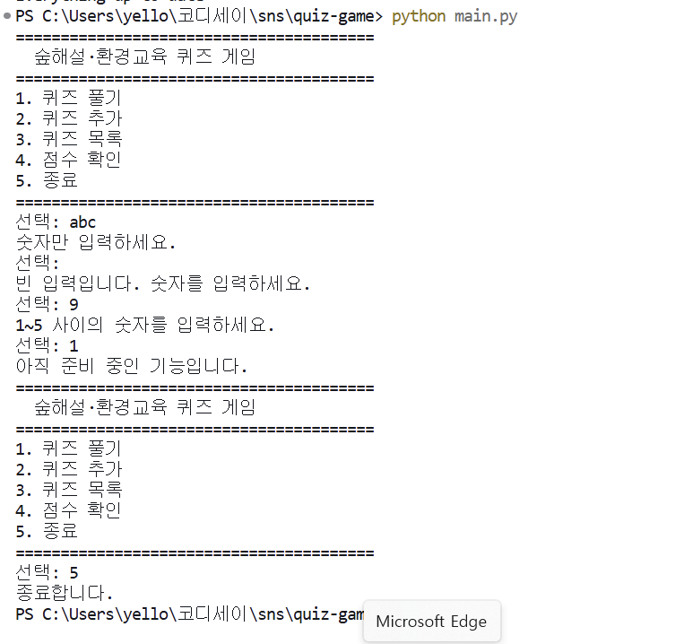 |
| 퀴즈 풀기 | 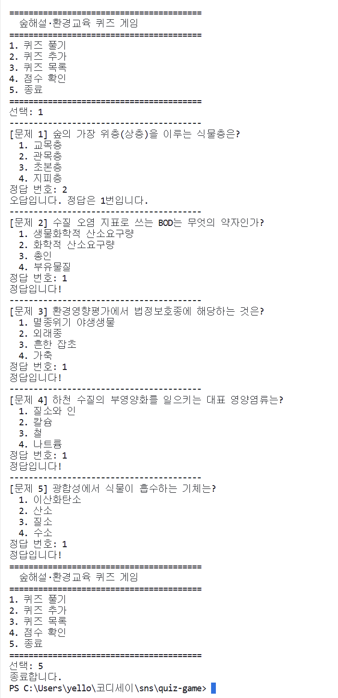 |
| 결과 점수 | 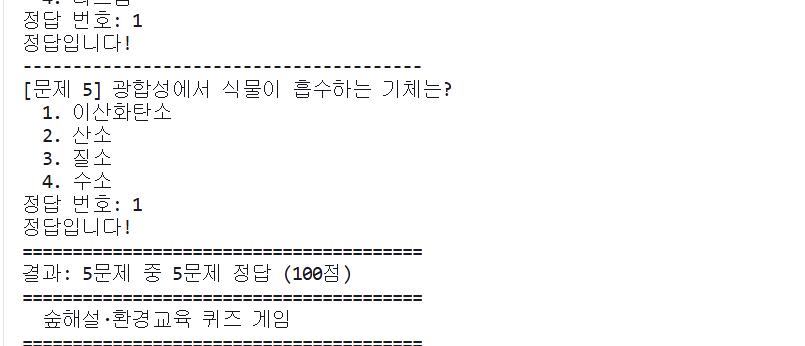 |
| 퀴즈 추가 | 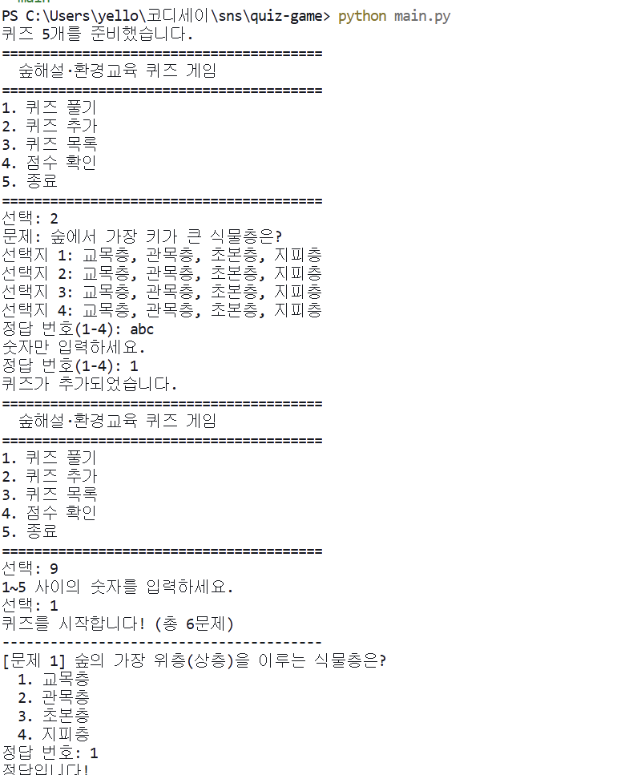 |
| 퀴즈 목록 | 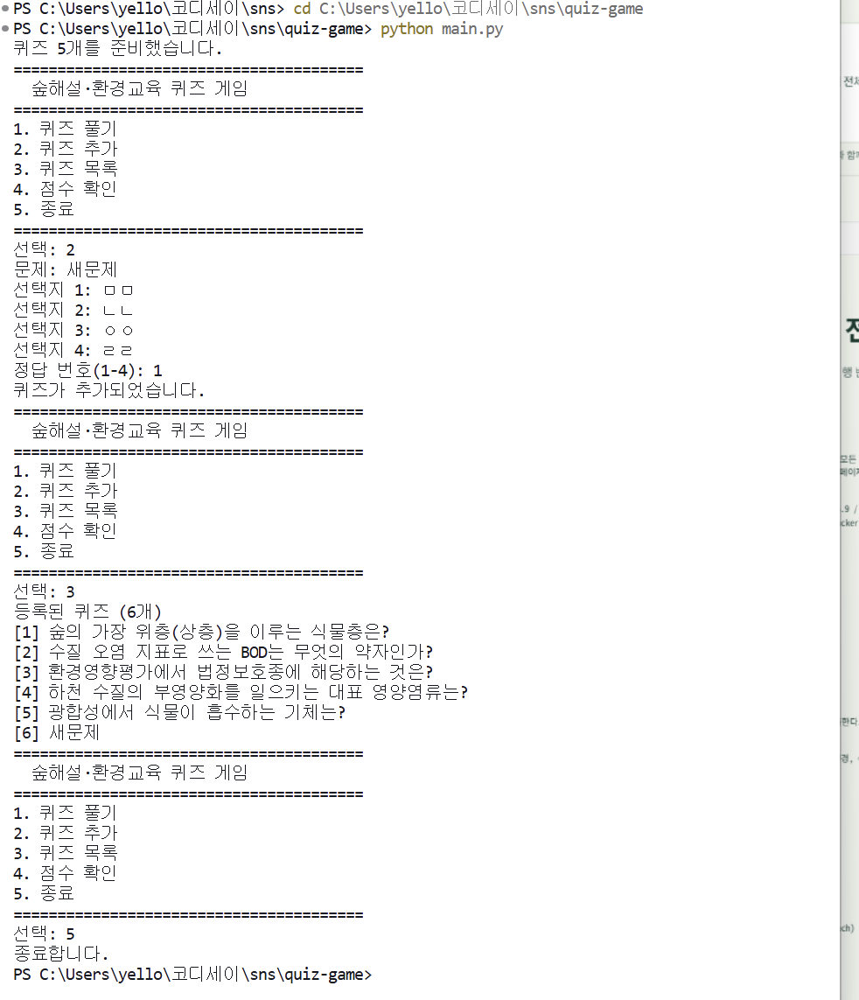 |
| 점수 확인 | 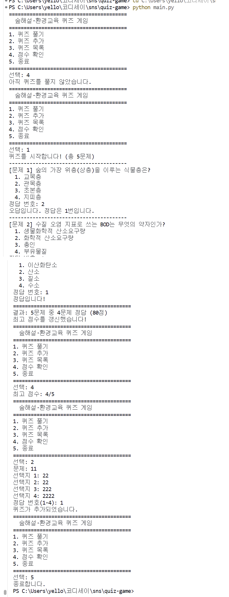 |
| `state.json` 저장 내용 | 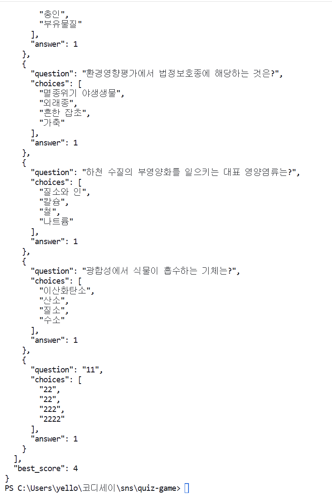 |
| 껐다 켜도 유지됨 | 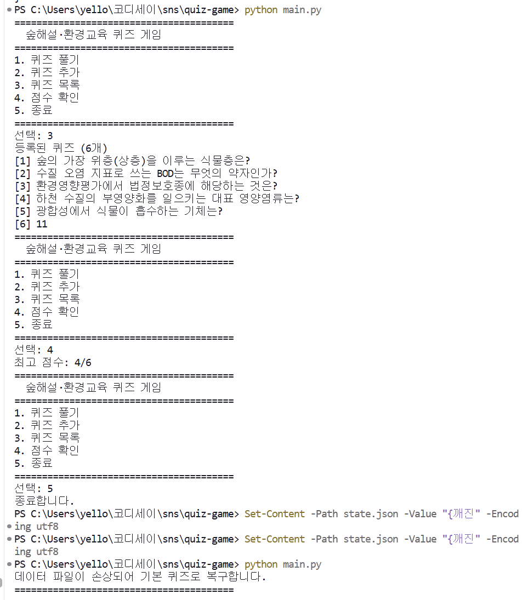 |
| 손상된 파일 복구 | 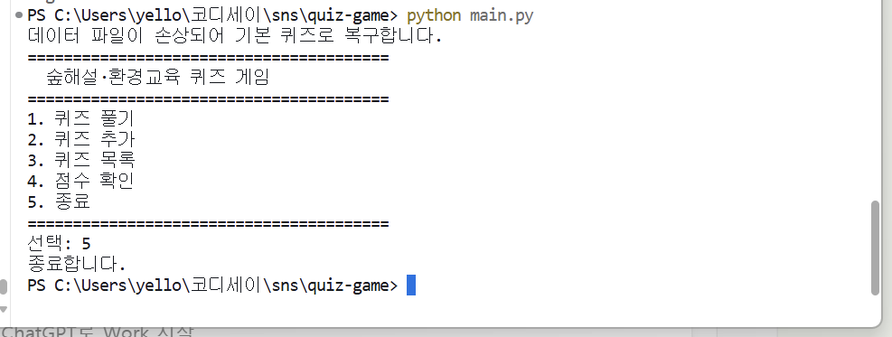 |

## 8. Git 작업 기록
### 커밋 (의미 단위로 나눠서 기록)
| # | 커밋 | 내용 |
|---|---|---|
| 1 | `29e3b37` Chore: 저장소 초기 설정 | `.gitignore`, `README.md` |
| 2 | `fbb6e05` Feat: 메뉴 기능과 입력 검증 구현 | 메뉴, 입력 검증 |
| 3 | `1b3ccfa` Feat: Quiz 클래스 구현 | `Quiz` 클래스 |
| 4 | `6f6ca04` Feat: 기본 퀴즈 데이터 5개 작성 | 기본 퀴즈 |
| 5 | `4899875` Feat: 퀴즈 풀기 기능 구현 | (브랜치 `feature/play-quiz`) |
| 6 | `b165a01` Feat: 퀴즈 결과 표시와 퀴즈 없음 처리 | (브랜치 `feature/play-quiz`) |
| 7 | `ad654b1` Merge: 퀴즈 풀기 기능 병합 | `main`에 병합 |
| 8 | `1ab5db8` Feat: 퀴즈 추가 기능 구현 | 퀴즈 추가 |
| 9 | `5c21bb9` Feat: 퀴즈 목록 기능 구현 | 퀴즈 목록 |
| 10 | `7a428f1` Feat: 점수 확인과 최고 점수 갱신 구현 | 점수 |
| 11 | `cc89c38` Refactor: QuizGame 클래스로 구조 정리 | 클래스 구조 정리 |
| 12 | `6fba925` Feat: state.json 저장·불러오기와 예외 처리 구현 | 파일 입출력 |
| 13 | `7631254` Docs: README 작성 | README |
| 14 | `6ef3e4d` Docs: 실행 화면과 Git 작업 증거 스크린샷 추가 | 증거 이미지 |
| 15 | `70ed031` Docs: clone 실습용 README 한 줄 추가 | 복제 저장소(`quiz-game-clone`)에서 작성, `pull`로 가져옴 |
| 16 | `c32846c` Docs: clone·pull 실습 기록과 Git 작업 기록 정리 | README 8~10장 |
| 17 | `49c4afa` Docs: clone·pull 실습 증거 스크린샷 추가 | 증거 이미지 |
| 18 | Docs: 개발 환경 설정과 제출 증빙 정리 | 이 README의 11장 |
| 19 | Docs: 개발 환경 설정과 최종 커밋 그래프 증빙 추가 | 증거 이미지 (`S40`, `S41`) |

### 브랜치와 병합
`main`에서 `feature/play-quiz` 브랜치를 만들어 퀴즈 풀기 기능(커밋 5, 6)을 개발한 뒤, `git merge --no-ff`로 `main`에 병합했습니다. 병합 기록이 남도록 `--no-ff`를 사용했습니다.

| 단계 | 화면 |
|---|---|
| 브랜치 생성과 이동 (`git checkout -b feature/play-quiz`) | 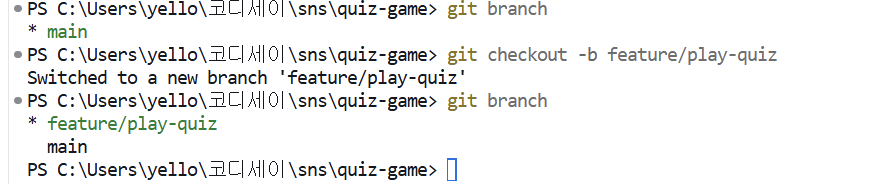 |
| 병합 **전** `main`에는 퀴즈 풀기가 없음 ("아직 준비 중인 기능입니다.") | 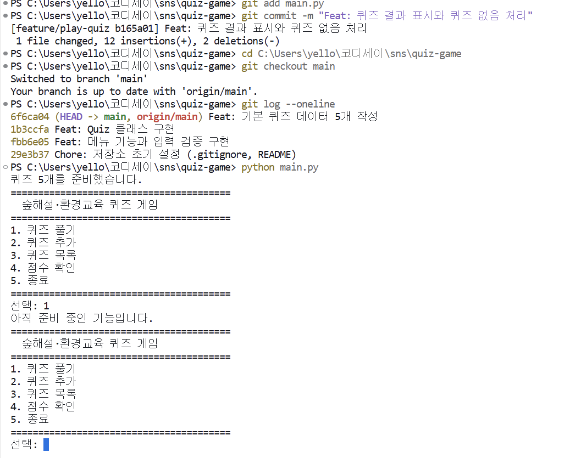 |
| 병합 **후** 갈라졌다 합쳐지는 그래프 | 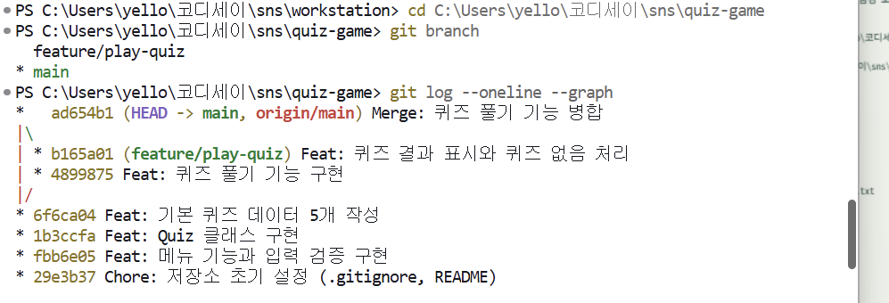 |

### 사용한 Git 명령 7종
| 명령 | 사용한 곳 |
|---|---|
| `init` | 저장소 시작 |
| `add` | 커밋 전 파일 담기 |
| `commit` | 기능 단위 저장 |
| `push` | GitHub로 올리기 |
| `pull` | 복제 저장소에서 올린 변경을 원래 폴더로 가져오기 (9장) |
| `checkout` | 브랜치 생성과 이동 (`checkout -b feature/play-quiz`, `checkout main`) |
| `clone` | 별도 폴더에 저장소 복제 (9장) |

## 9. clone / pull 실습
**목표:** `clone`으로 저장소를 별도 폴더에 복제하고, 복제본에서 고쳐 `push`한 변경을 원래 폴더에서 `pull`로 가져와 반영되는지 확인합니다.

| 순서 | 위치 | 명령 | 결과 |
|---|---|---|---|
| 1 | `sns/` | `git clone git@github.com:80gina/quiz-game.git quiz-game-clone` | 복제본 폴더 생성, 커밋 14개가 그대로 복사됨 |
| 2 | `quiz-game-clone/` | README 끝에 한 줄 추가 후 `git add`, `git commit` | 커밋 `70ed031` |
| 3 | `quiz-game-clone/` | `git push` | `6ef3e4d..70ed031  main -> main` |
| 4 | `quiz-game/` (원래 폴더) | `git pull` | `Updating 6ef3e4d..70ed031`, `Fast-forward`, `README.md | 1 +` |
| 5 | `quiz-game/` | `git log --oneline -3`, README 마지막 줄 확인 | 맨 위 커밋과 추가한 한 줄이 반영됨 |

### 1) clone: 복제본 확인
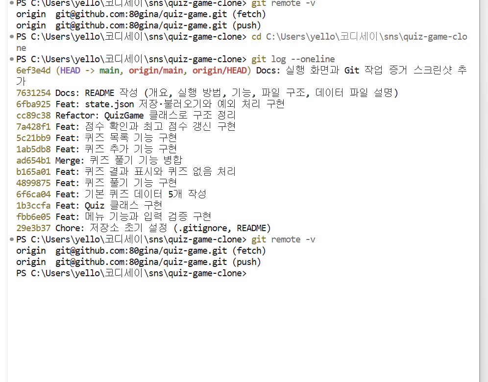

### 2~3) 복제본에서 수정, 커밋, push
복제본에서 추가한 한 줄:
```text
- clone 실습: 복제 저장소(quiz-game-clone)에서 이 줄을 추가하고 push했습니다.
```
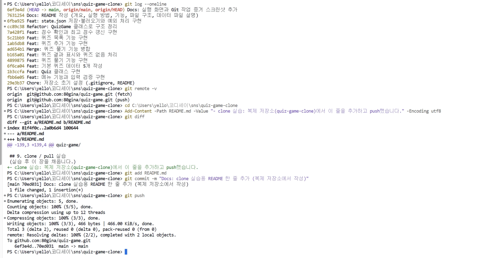

### 4~5) 원래 폴더에서 pull, 반영 확인
`pull` 전에는 README가 `(실습 후 이 장을 채웁니다.)`로 끝났고, `pull` 후에는 복제본에서 추가한 줄이 들어왔습니다. 충돌 없이 `Fast-forward`로 가져왔습니다.

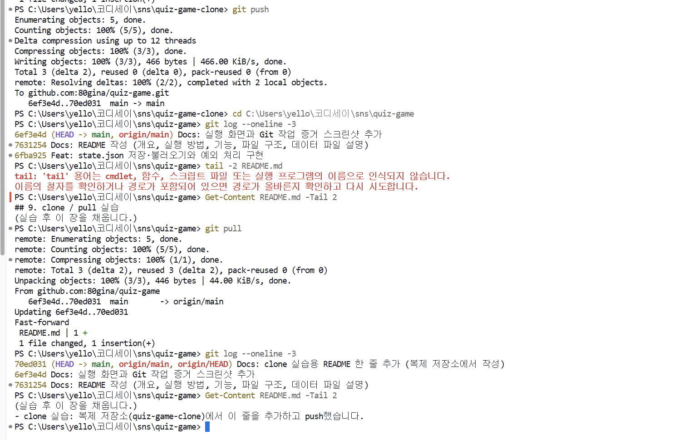

### clone과 pull의 차이
| | clone | pull |
|---|---|---|
| 하는 일 | 저장소 **전체**를 새 폴더에 복사 | 이미 가진 저장소에 **새로 바뀐 것만** 가져옴 |
| 쓰는 때 | 처음 시작할 때 한 번 | 그 뒤 매번 |

## 10. 겪은 오류와 해결
| 오류 | 원인 | 해결 | 화면 |
|---|---|---|---|
| `fatal: not a git repository` | 저장소가 아닌 상위 폴더(`sns`)에서 명령을 실행함 | `cd`로 `quiz-game`으로 이동 후 다시 실행 | 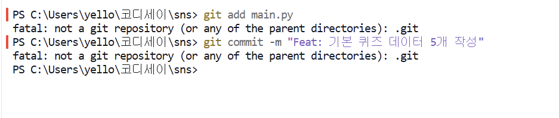 |
| `fatal: not a git repository` (`git push origin feature/play-quiz`) | 다른 터미널 탭이 상위 폴더에 있었음 | 맨 끝 폴더 이름을 확인하고 이동 | 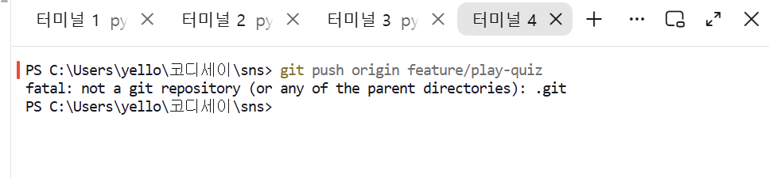 |
| 커밋 메시지가 기능과 다름 (`추가`로 적힌 `목록` 커밋) | 이전 커밋 명령을 그대로 반복함 | 올리기 전이라 `git commit --amend -m`으로 메시지만 수정 | (8장의 커밋 표에서 `목록` 커밋 확인) |

## 11. 개발 환경과 제출 증빙
### 개발 환경
| 항목 | 내용 | 과제 요구 |
|---|---|---|
| OS / 셸 | Windows 11 / PowerShell | - |
| Python | **3.14.7** | 3.10 이상 ✅ |
| Git | 2.53.0.windows.3 | - |
| 편집기 | VSCode | - |
| 외부 라이브러리 | 없음 (표준 라이브러리 `json`, `os`만 사용) | 외부 라이브러리 금지 ✅ |

### Git 설정
| 항목 | 값 |
|---|---|
| `user.name` | 설정함 |
| `init.defaultBranch` | `main` |
| `remote.origin.url` | `git@github.com:80gina/quiz-game.git` (SSH) |
| `branch.main` | `origin`의 `main`을 추적 |

이메일은 공개 저장소에 노출되지 않도록 `git config --list | Select-String -NotMatch "user.email"`로 **이메일 줄을 제외하고** 출력했습니다. (`init.defaultbranch`가 `master`와 `main`으로 두 번 보이는 것은 시스템 기본값 뒤에 내 설정(`main`)이 덮어써서 `main`이 적용되기 때문입니다.)

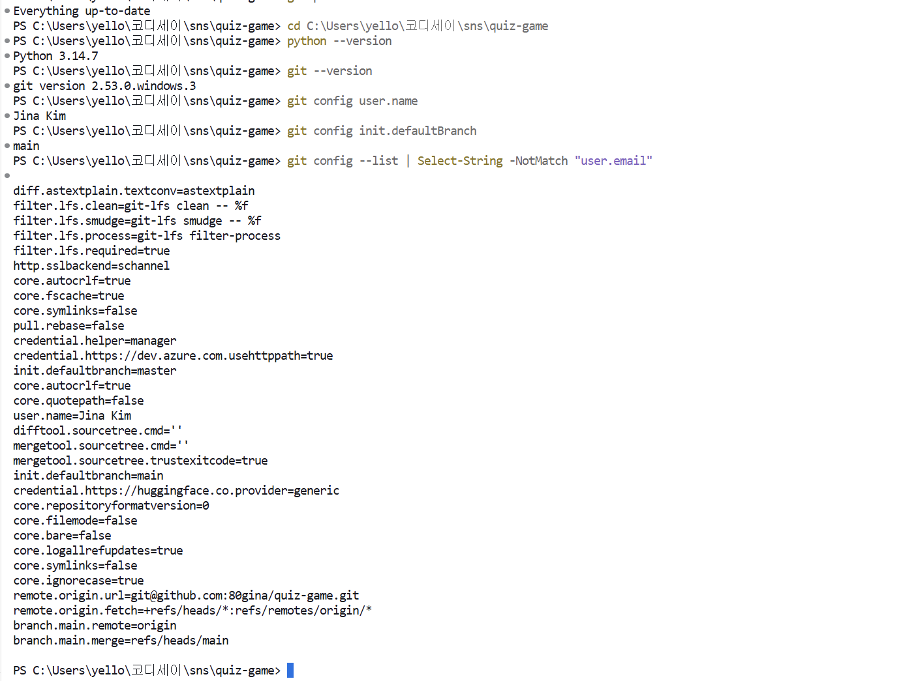

### 최종 커밋 그래프 (`git log --oneline --graph`)
커밋이 순서대로 쌓여 있고, `feature/play-quiz` 브랜치가 갈라졌다가 `Merge` 커밋으로 `main`에 합쳐진 것을 볼 수 있습니다.

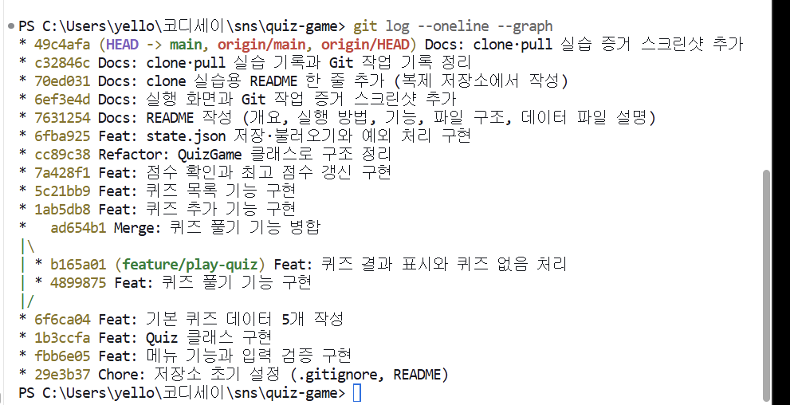

### 제출물 확인
| 제출물 | 위치 |
|---|---|
| GitHub 저장소 URL | https://github.com/80gina/quiz-game |
| 개발 환경 설정 스크린샷 (Python 버전, Git 설정) | 11장 `S40` |
| 프로그램 실행 결과 스크린샷 (추가, 목록, 플레이, 점수) | 7장 (`S19`, `S21`, `S9`, `S11`, `S23`) |
| `git log --oneline --graph` 출력 | 11장 `S41` |
