# 숲해설·환경교육 퀴즈 게임

터미널에서 동작하는 퀴즈 게임입니다. 퀴즈를 풀고, 새 퀴즈를 추가하고, 목록과 최고 점수를 확인할 수 있고, 프로그램을 끄고 다시 켜도 **퀴즈와 최고 점수가 `state.json`에 남습니다.**

> 🆕 **2차 평가 피드백을 반영했습니다** — 바뀐 곳은 🔧(코드) 🧪(테스트) 📝(문서) 📊(증빙) 아이콘으로 표시했고, 전체 목록은 [14장](#14-2차-평가-피드백-반영-보완-내용)에 있습니다.

> 🔗 **3번 미션 연결:** 이 게임의 `AI 패턴 퀴즈`(메뉴 6)는 3번 미션 **[Mini NPU 시뮬레이터](https://github.com/80gina/mini-npu)** 의 MAC 연산 로직을 가져와 만들었습니다. 자세한 내용은 [12장](#12-3번-미션-연결-ai-패턴-퀴즈)을 보세요.

> 📚 **평가 문항별 질문과 답변:** 모든 문항의 답변은 [docs/QNA.md](docs/QNA.md)에 있고, 이 문서의 해당 절마다 💬 **평가 질문** 주석에서 바로 연결됩니다.

## 1. 프로젝트 개요
| 항목 | 내용 |
|---|---|
| 목표 | Python 기본 문법, 클래스(객체 지향), 파일 입출력(JSON), Git(브랜치·병합·clone·pull) 연습 |
| 언어 | Python 3.10 이상 (표준 라이브러리만 사용, 외부 라이브러리 없음) |
| 구조 | `Quiz`(퀴즈 한 문제), `QuizGame`(게임 전체) 클래스 2개 |
| 저장 | 프로젝트 루트의 `state.json` (UTF-8) |

## 2. 퀴즈 주제와 선정 이유

> 💬 **평가 질문 Q1-4** — 기본 퀴즈가 5개 이상인가? → [답변 보기](docs/QNA.md#q1-4)

- **주제:** 숲, 생태, 수질, 환경영향평가
- **선정 이유:** 숲해설·환경교육·환경영향평가 업무와 직접 연결되어 문제를 만들기 쉽고, 교육 현장에서 바로 쓸 수 있는 주제이기 때문입니다.
- **기본 퀴즈:** 5문제 (식물층, BOD, 법정보호종, 부영양화, 광합성)

## 3. 실행 방법
```bash
python main.py
```
실행하면 아래 메뉴가 나옵니다. (기대 출력)
```text
========================================
  숲해설·환경교육 퀴즈 게임
========================================
1. 퀴즈 풀기
2. 퀴즈 추가
3. 퀴즈 목록
4. 점수 확인
5. 종료
6. AI 패턴 퀴즈 (3번 미션: MAC 연산 체험)
========================================
선택:
```
Windows에서 `python`이 안 되면 `py main.py`를 사용합니다. 메뉴에서 번호를 입력해 기능을 선택합니다. (`5`로 종료)

## 4. 기능 목록

> 💬 **평가 질문 Q1-1** — 메뉴가 표시되고 퀴즈 풀기/추가/목록/점수 확인이 모두 동작하는가? → [답변 보기](docs/QNA.md#q1-1)

| 메뉴 | 기능 | 설명 |
|---|---|---|
| 1 | 퀴즈 풀기 | 저장된 퀴즈를 차례로 출제하고 정답/오답을 알려 주며, 끝나면 점수를 보여 줍니다. 퀴즈가 없으면 안내합니다. |
| 2 | 퀴즈 추가 | 문제, 선택지 4개, 정답 번호(1~4)를 입력받아 새 퀴즈를 등록하고 저장합니다. |
| 3 | 퀴즈 목록 | 등록된 퀴즈의 문제를 번호와 함께 보여 줍니다. 퀴즈가 없으면 안내합니다. |
| 4 | 점수 확인 | 최고 점수를 보여 줍니다. 퀴즈를 풀 때마다 최고 점수와 비교해 갱신합니다. 안 풀었으면 안내합니다. |
| 5 | 종료 | 저장하고 종료합니다. |
| 6 | AI 패턴 퀴즈 | 그림(5×5, 13×13)을 보고 Cross(십자가)/X를 맞히면, AI(MAC 연산)가 계산한 점수를 함께 보여 줍니다. (3번 미션 연결, 12장) |

### 입력과 오류 처리

> 💬 **평가 질문 Q1-2** — 정답/오답 판정이 정확하고 입력 오류(공백/문자/범위 밖/빈 입력)를 처리하는가? → [답변 보기](docs/QNA.md#q1-2)
>
> 💬 **평가 질문 Q2-4** — Ctrl+C 또는 EOF에서 안전 종료를 위해 어떤 처리를 했나요? → [답변 보기](docs/QNA.md#q2-4)

| 상황 | 처리 |
|---|---|
| 앞뒤 공백 (` 5 `) | 공백을 지우고 처리합니다. |
| 숫자가 아닌 입력 (`abc`) | `숫자만 입력하세요.` 후 다시 입력받습니다. |
| 범위 밖 숫자 (메뉴 `9`, 정답 `0`) | 범위를 안내하고 다시 입력받습니다. |
| 빈 입력 (그냥 Enter) | 안내하고 다시 입력받습니다. |
| `Ctrl+C`, 입력 스트림 종료(EOF) | 비정상 종료하지 않고 안내 후 **저장하고 안전하게 종료**합니다. |
| `state.json`이 없음 (첫 실행) | 기본 퀴즈 5개로 시작합니다. |
| `state.json`이 손상됨 | 안내 후 **손상된 파일을 `state.json.bak`로 보관**하고 기본 퀴즈로 복구합니다. |
| 저장 실패 (권한·디스크) | `저장 실패: 원인 (폴더 쓰기 권한과 디스크 공간을 확인하세요…)`를 안내하고 프로그램은 계속 실행합니다. |

**오류 메시지 표준 문구:** `<무엇이 잘못됐는지>. <어떻게 입력하면 되는지>.` 한 문장 템플릿을 씁니다.
| 상황 | 문구 |
|---|---|
| 빈 입력 | `빈 입력입니다. 숫자를 입력하세요.` |
| 숫자가 아님 | `숫자만 입력하세요.` |
| 범위 밖 | `1~4 사이의 숫자를 입력하세요.` (범위는 상황에 맞게 바뀜) |

## 5. 파일 구조
```
quiz-game/
├── main.py        # Quiz, PatternQuiz, QuizGame 클래스와 실행 코드
├── npu_core.py    # MAC 연산, 라벨 정규화, 허용오차 비교, 패턴 생성 (3번 미션 로직)
├── test_quizgame.py  # 🧪 자동 테스트 (표준 라이브러리 unittest)
├── data.json      # AI 패턴 퀴즈용 필터와 패턴 (3번 미션과 같은 형식)
├── state.json     # 퀴즈와 최고 점수 (프로그램이 자동 생성·갱신, 저장소에는 올리지 않음)
├── .gitignore     # 파이썬 임시 파일 무시
├── README.md      # 이 문서
└── docs/
    └── screenshots/   # 실행 화면과 Git 작업 증거
```

### 코드 구성 (`main.py`)

> 💬 **평가 질문 Q2-1** — Quiz와 QuizGame의 책임을 어떻게 나눴나요? → [답변 보기](docs/QNA.md#q2-1)
>
> 💬 **평가 질문 Q2-2** — 입력 처리, 게임 진행, 저장/불러오기를 어떤 기준으로 분리했나요? → [답변 보기](docs/QNA.md#q2-2)
>
> 💬 **평가 질문 Q3-1** — 클래스를 쓴 이유, 함수만 쓸 때와의 차이는? → [답변 보기](docs/QNA.md#q3-1)

| 이름 | 종류 | 역할 |
|---|---|---|
| `Quiz` | 클래스 | 속성 `question`, `choices`, `answer`. 메서드 `show()`, `is_correct()`, `to_dict()`, `from_dict()` |
| `default_quizzes()` | 함수 | 기본 퀴즈 5개를 `Quiz` 인스턴스로 만들어 돌려줍니다. |
| `PatternQuiz` | 클래스 | `Quiz`를 이어받은 그림 퀴즈. 그림을 보여 주는 `show()`를 바꿔 쓰고, `explain()`으로 MAC 점수를 설명 |
| `QuizGame` | 클래스 | 속성 `quizzes`, `best_score`. 메서드 `show_menu`, `play`, `play_pattern_quiz`, `add_quiz`, `list_quizzes`, `show_score`, `load`, `save`, `run`, 입력 도우미 `read_line`, `read_int` |
| `load_pattern_quizzes()` | 함수 | `data.json`을 읽어 `PatternQuiz` 목록을 만듦 (크기 불일치·라벨 오류는 건너뜀) |

**책임 경계 (한 문장씩)**
- `Quiz`: **한 문제**의 형식 검증(선택지 4개, 정답 1~4: `from_dict`), 출력, 채점, 딕셔너리 변환만 맡습니다.
- `QuizGame`: 사용자 **입력 검증**(`read_line`, `read_int`), **게임 진행**(메뉴·풀기·추가·점수), **파일 저장/불러오기**(`load`, `save`)를 맡습니다.

**호출 흐름:** `QuizGame()` 생성 → `load()` → `run()`이 `show_menu()`와 `read_int()`로 번호를 받아 `play()`·`add_quiz()`·`list_quizzes()`·`show_score()`를 호출하고, 점수가 바뀌거나 퀴즈를 추가하거나 종료할 때 `save()`가 호출됩니다. 모든 입력은 `read_line()`을 거쳐 Ctrl+C·EOF를 한곳에서 처리합니다.

**클래스를 선택한 이유와 함수형 대안:** 함수만 쓰면 문제·선택지·정답을 따로 넘겨야 하지만, 클래스는 한 문제의 데이터와 채점 방법을 한 덩어리로 묶고 `PatternQuiz`처럼 상속으로 확장할 수 있어 클래스를 선택했습니다.

## 6. 데이터 파일 설명 (`state.json`)

> 💬 **평가 질문 Q1-3** — 종료 후 재실행해도 추가한 퀴즈와 최고 점수가 유지되는가? → [답변 보기](docs/QNA.md#q1-3)
>
> 💬 **평가 질문 Q2-3** — `state.json` 읽기/쓰기는 어디서 어떤 순서로 일어나나요? → [답변 보기](docs/QNA.md#q2-3)
>
> 💬 **평가 질문 Q3-2** — JSON으로 저장하는 이유와 특징은? → [답변 보기](docs/QNA.md#q3-2)

| 항목 | 내용 |
|---|---|
| 경로 | 프로젝트 루트 (`main.py`와 같은 폴더) |
| 인코딩 | UTF-8 (한글이 깨지지 않도록 `ensure_ascii=False`) |
| 역할 | 프로그램을 끄고 다시 켜도 추가한 퀴즈와 최고 점수를 유지 |
| 생성 시점 | 퀴즈를 풀거나 추가할 때, 종료할 때 자동 저장 |

### 스키마

> 💬 **평가 질문 Q3-5** — `state.json` 구조를 지금 형태로 설계한 이유는? → [답변 보기](docs/QNA.md#q3-5)
>
> 💬 **평가 질문 Q4-7** — `category` 필드는 왜 추가했나요? → [답변 보기](docs/QNA.md#q4-7)

```json
{
  "quizzes": [
    {
      "question": "문제 문장",
      "choices": ["선택지 1", "선택지 2", "선택지 3", "선택지 4"],
      "answer": 1,
      "category": "숲해설"
    }
  ],
  "best_score": 5
}
```
| 키 | 타입 | 설명 |
|---|---|---|
| `quizzes` | 리스트 | 퀴즈 목록 |
| `quizzes[].question` | 문자열 | 문제 |
| `quizzes[].choices` | 문자열 4개 리스트 | 선택지 |
| `quizzes[].answer` | 정수 (1~4) | 정답 번호 |
| `quizzes[].category` 🔧 | 문자열 (선택) | 분류. 향후 확장용이며 **없는 옛 파일도 읽힙니다**(기본값 `일반`) |
| `best_score` | 정수 또는 `null` | 최고 정답 수 (아직 안 풀었으면 `null`) |

**JSON을 고른 이유:** 파이썬의 리스트·딕셔너리와 모양이 같아 변환이 쉽고, 사람이 읽고 고칠 수 있는 텍스트이며, 중첩 구조(퀴즈 안의 선택지)를 그대로 담을 수 있어서입니다. CSV는 선택지 같은 목록을 한 칸에 담기 어렵습니다.

**불러오기 순서:** 시작 시 `load()`로 읽습니다 → 파일이 없으면 기본 퀴즈(5개)를 쓰고(저장은 첫 풀기·추가·종료 때) → 손상됐으면 `.bak`로 보관한 뒤 기본 퀴즈로 시작해 `save()`로 새 파일을 만듭니다. 이유는 프로그램이 항상 실행 가능한 상태로 시작하게 하기 위해서입니다.

**안전한 저장:** `save()`는 `state.json.tmp`에 먼저 쓰고 성공하면 `os.replace()`로 교체합니다. 쓰는 도중 꺼져도 기존 `state.json`은 그대로 남습니다. `.bak`, `.tmp`는 저장소에 올리지 않습니다.

`state.json`은 실행할 때마다 바뀌는 기록 파일이라 저장소에는 포함하지 않았습니다. 구조와 실제 내용은 아래 스크린샷에서 확인할 수 있습니다.

## 7. 실행 결과 스크린샷
| 기능 | 화면 |
|---|---|
| 메뉴, 입력 검증 (`abc`, 빈 입력, `9`) | 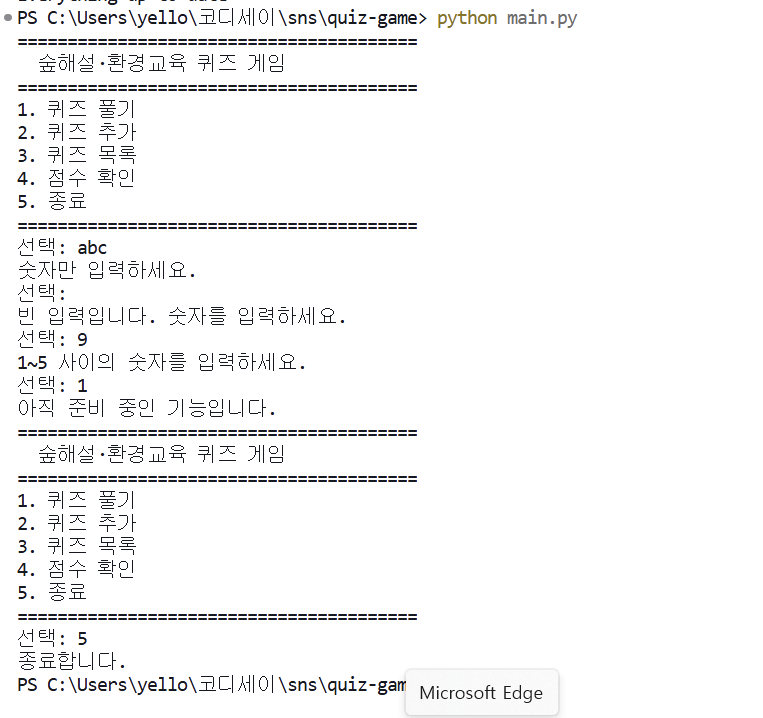 |
| 퀴즈 풀기 | 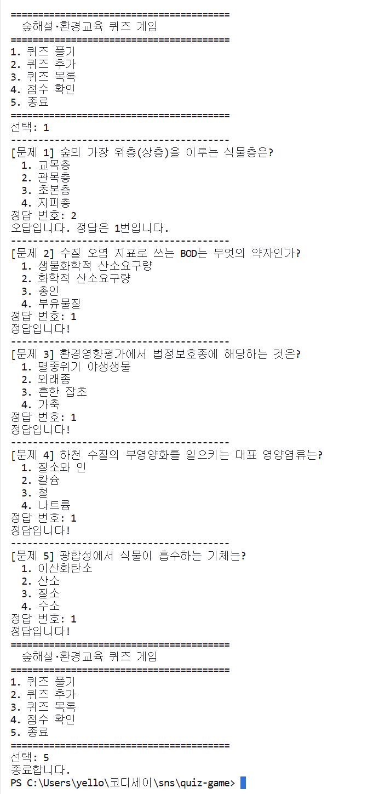 |
| 결과 점수 | 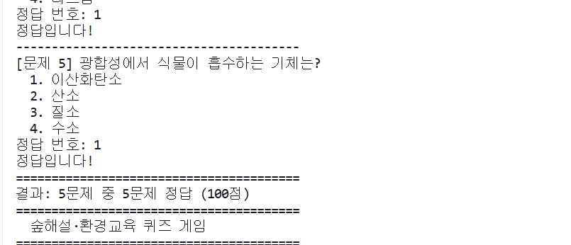 |
| 퀴즈 추가 | 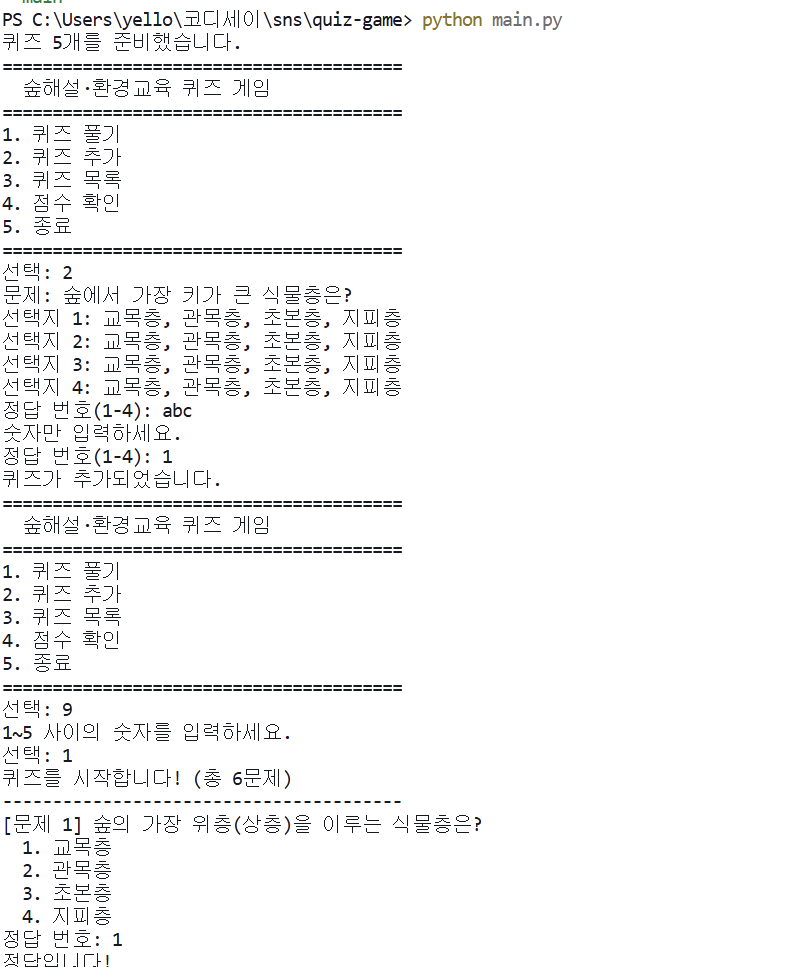 |
| 퀴즈 목록 | 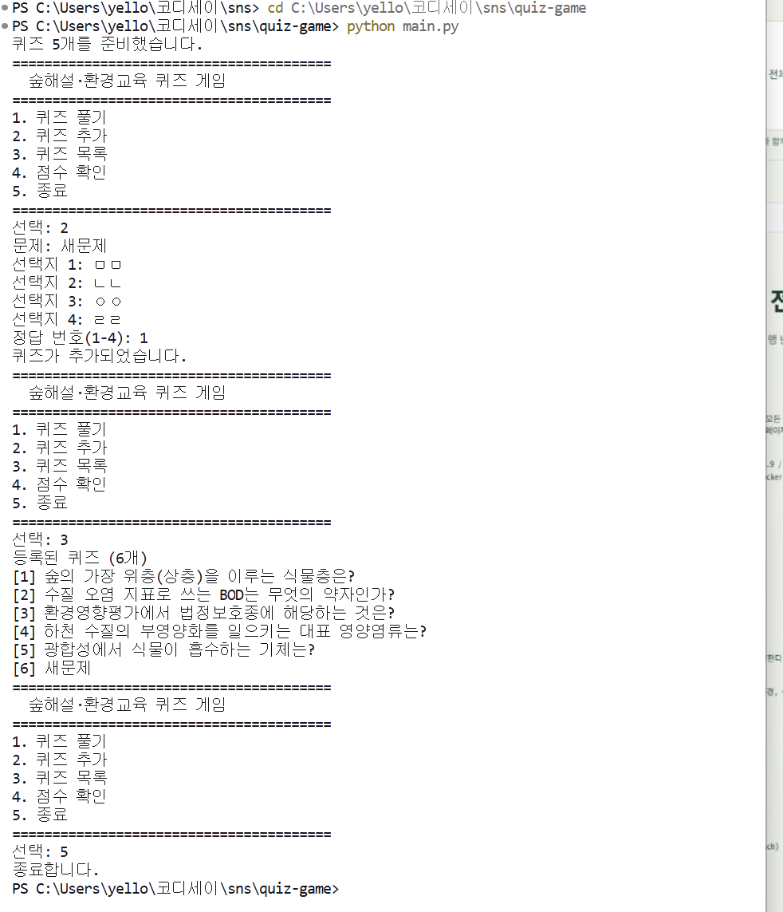 |
| 점수 확인 | 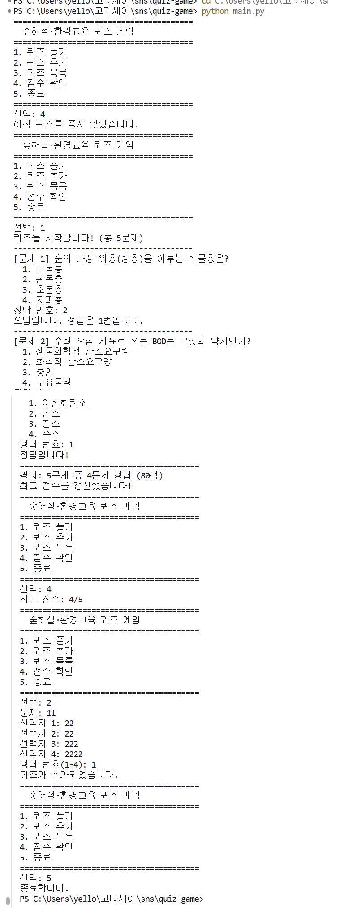 |
| `state.json` 저장 내용 | 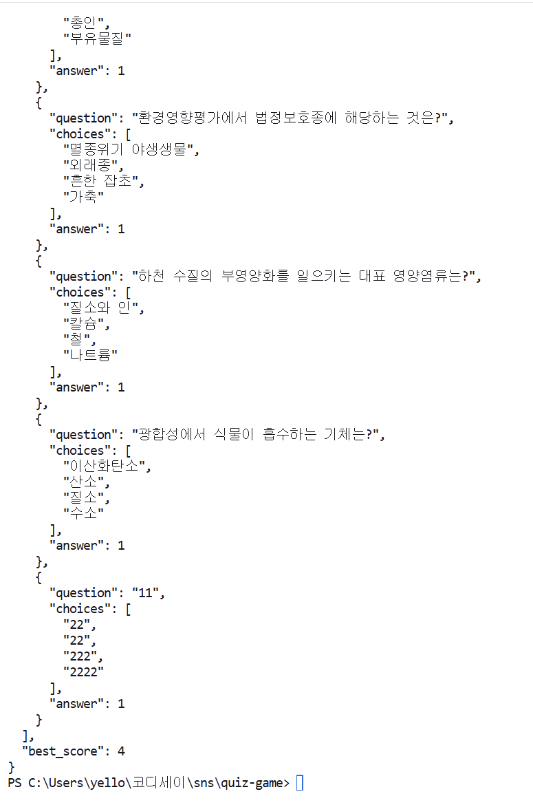 |
| 껐다 켜도 유지됨 | 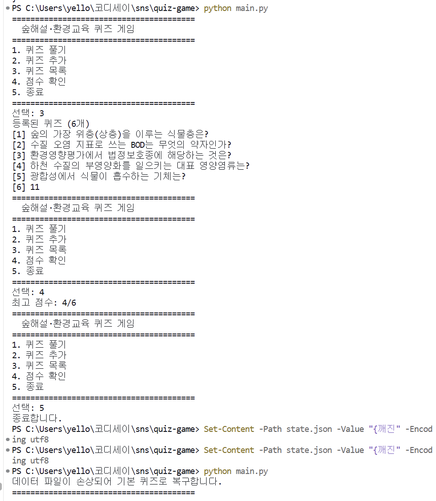 |
| 손상된 파일 복구 | 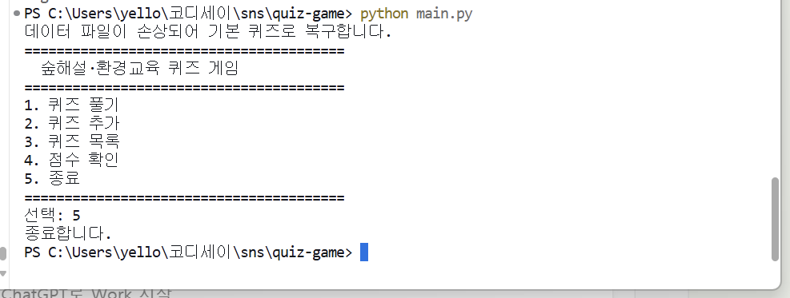 |

## 8. Git 작업 기록
### 커밋 (의미 단위로 나눠서 기록)

> 💬 **평가 질문 Q1-5** — GitHub에 코드가 올라가 있고 10개 이상의 의미 있는 커밋이 있는가? → [답변 보기](docs/QNA.md#q1-5)
>
> 💬 **평가 질문 Q2-5** — 커밋을 어떤 단위로 나누고 메시지 규칙은? → [답변 보기](docs/QNA.md#q2-5)

| # | 커밋 | 내용 |
|---|---|---|
| 1 | `29e3b37` Chore: 저장소 초기 설정 | `.gitignore`, `README.md` |
| 2 | `fbb6e05` Feat: 메뉴 기능과 입력 검증 구현 | 메뉴, 입력 검증 |
| 3 | `1b3ccfa` Feat: Quiz 클래스 구현 | `Quiz` 클래스 |
| 4 | `6f6ca04` Feat: 기본 퀴즈 데이터 5개 작성 | 기본 퀴즈 |
| 5 | `4899875` Feat: 퀴즈 풀기 기능 구현 | (브랜치 `feature/play-quiz`) |
| 6 | `b165a01` Feat: 퀴즈 결과 표시와 퀴즈 없음 처리 | (브랜치 `feature/play-quiz`) |
| 7 | `ad654b1` Merge: 퀴즈 풀기 기능 병합 | `main`에 병합 |
| 8 | `1ab5db8` Feat: 퀴즈 추가 기능 구현 | 퀴즈 추가 |
| 9 | `5c21bb9` Feat: 퀴즈 목록 기능 구현 | 퀴즈 목록 |
| 10 | `7a428f1` Feat: 점수 확인과 최고 점수 갱신 구현 | 점수 |
| 11 | `cc89c38` Refactor: QuizGame 클래스로 구조 정리 | 클래스 구조 정리 |
| 12 | `6fba925` Feat: state.json 저장·불러오기와 예외 처리 구현 | 파일 입출력 |
| 13 | `7631254` Docs: README 작성 | README |
| 14 | `6ef3e4d` Docs: 실행 화면과 Git 작업 증거 스크린샷 추가 | 증거 이미지 |
| 15 | `70ed031` Docs: clone 실습용 README 한 줄 추가 | 복제 저장소(`quiz-game-clone`)에서 작성, `pull`로 가져옴 |
| 16 | `c32846c` Docs: clone·pull 실습 기록과 Git 작업 기록 정리 | README 8~10장 |
| 17 | `49c4afa` Docs: clone·pull 실습 증거 스크린샷 추가 | 증거 이미지 |
| 18 | `c0b5b62` Docs: 개발 환경 설정과 제출 증빙 정리 | README 11장 |
| 19 | `faa47a0` Docs: 개발 환경 설정과 최종 커밋 그래프 증빙 추가 | 증거 이미지 (`S40`, `S41`) |
| 20 | `fd06eb4` Feat: NPU 핵심 연산 모듈 추가 | (브랜치 `feature/npu-quiz`) `npu_core.py` |
| 21 | `7ce1760` Feat: PatternQuiz와 AI 패턴 퀴즈 메뉴 추가 | (브랜치 `feature/npu-quiz`) |
| 22 | `9d2a1f5` Feat: data.json에서 패턴 불러오기 | (브랜치 `feature/npu-quiz`) 3번 미션 데이터 형식 공유 |
| 23 | `5158cb5` Docs: 3번 미션 연결 설명 추가 (AI 패턴 퀴즈) | (브랜치 `feature/npu-quiz`) README 12장 |
| 24 | `f3b2e74` Docs: 3번 미션 연결 증거 스크린샷 추가 | (브랜치 `feature/npu-quiz`) 증거 이미지 |
| 25 | `0abd8f0` Merge: AI 패턴 퀴즈(3번 미션 연결) 병합 | `main`에 두 번째 병합 |
| 26 | Docs: 두 번째 병합 증거 추가 | 병합 그래프와 병합 후 메뉴 6번 화면 (`N10`) |

전체 커밋 목록: [github.com/80gina/quiz-game/commits/main](https://github.com/80gina/quiz-game/commits/main) (명령: `git log --oneline`)

**커밋 단위 규칙:** 기능(또는 문서) 하나가 끝나면 커밋 하나, 메시지는 `Feat/Fix/Docs/Refactor/Merge: 작업 요약`.

### 브랜치와 병합

> 💬 **평가 질문 Q1-6** — 브랜치 생성·병합이 `git log --oneline --graph`에서 확인되는가? → [답변 보기](docs/QNA.md#q1-6)
>
> 💬 **평가 질문 Q3-4** — 브랜치를 분리한 이유와 병합의 의미는? → [답변 보기](docs/QNA.md#q3-4)

`main`에서 `feature/play-quiz` 브랜치를 만들어 퀴즈 풀기 기능(커밋 5, 6)을 개발한 뒤, `git merge --no-ff`로 `main`에 병합했습니다. 병합 기록이 남도록 `--no-ff`를 사용했습니다.
```text
git checkout main
git merge --no-ff feature/play-quiz -m "Merge: 퀴즈 풀기 기능 병합"   → 병합 커밋 ad654b1 (부모: 6f6ca04, b165a01)
```
(두 번째 병합은 `feature/npu-quiz`를 같은 방식으로 병합한 `0abd8f0`입니다. `git log --merges`로 확인할 수 있습니다.)

| 단계 | 화면 |
|---|---|
| 브랜치 생성과 이동 (`git checkout -b feature/play-quiz`) | 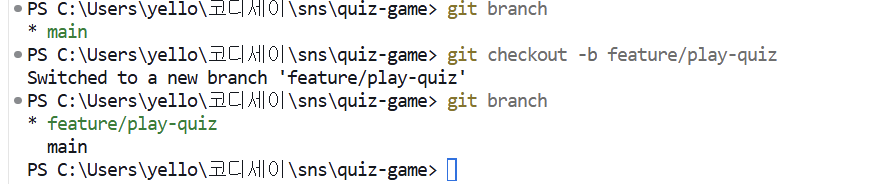 |
| 병합 **전** `main`에는 퀴즈 풀기가 없음 ("아직 준비 중인 기능입니다.") | 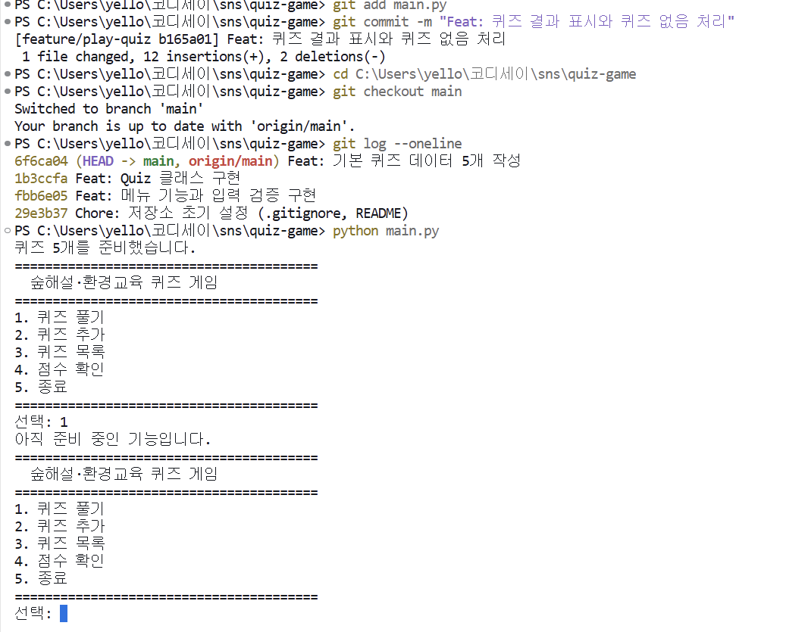 |
| 병합 **후** 갈라졌다 합쳐지는 그래프 | 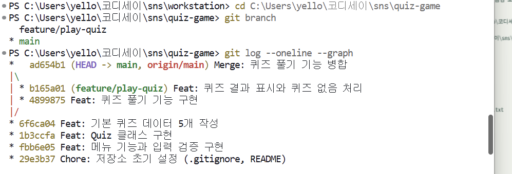 |

### 사용한 Git 명령 7종
| 명령 | 사용한 곳 |
|---|---|
| `init` | 저장소 시작 |
| `add` | 커밋 전 파일 담기 |
| `commit` | 기능 단위 저장 |
| `push` | GitHub로 올리기 |
| `pull` | 복제 저장소에서 올린 변경을 원래 폴더로 가져오기 (9장) |
| `checkout` | 브랜치 생성과 이동 (`checkout -b feature/play-quiz`, `checkout main`) |
| `clone` | 별도 폴더에 저장소 복제 (9장) |

## 9. clone / pull 실습

> 💬 **평가 질문 Q1-7** — clone과 pull 실습 흔적이 있는가? → [답변 보기](docs/QNA.md#q1-7)

**목표:** `clone`으로 저장소를 별도 폴더에 복제하고, 복제본에서 고쳐 `push`한 변경을 원래 폴더에서 `pull`로 가져와 반영되는지 확인합니다.

| 순서 | 위치 | 명령 | 결과 |
|---|---|---|---|
| 1 | `sns/` | `git clone git@github.com:80gina/quiz-game.git quiz-game-clone` | 복제본 폴더 생성, 커밋 14개가 그대로 복사됨 |
| 2 | `quiz-game-clone/` | README 끝에 한 줄 추가 후 `git add`, `git commit` | 커밋 `70ed031` |
| 3 | `quiz-game-clone/` | `git push` | `6ef3e4d..70ed031  main -> main` |
| 4 | `quiz-game/` (원래 폴더) | `git pull` | `Updating 6ef3e4d..70ed031`, `Fast-forward`, `README.md | 1 +` |
| 5 | `quiz-game/` | `git log --oneline -3`, README 마지막 줄 확인 | 맨 위 커밋과 추가한 한 줄이 반영됨 |

### 1) clone: 복제본 확인
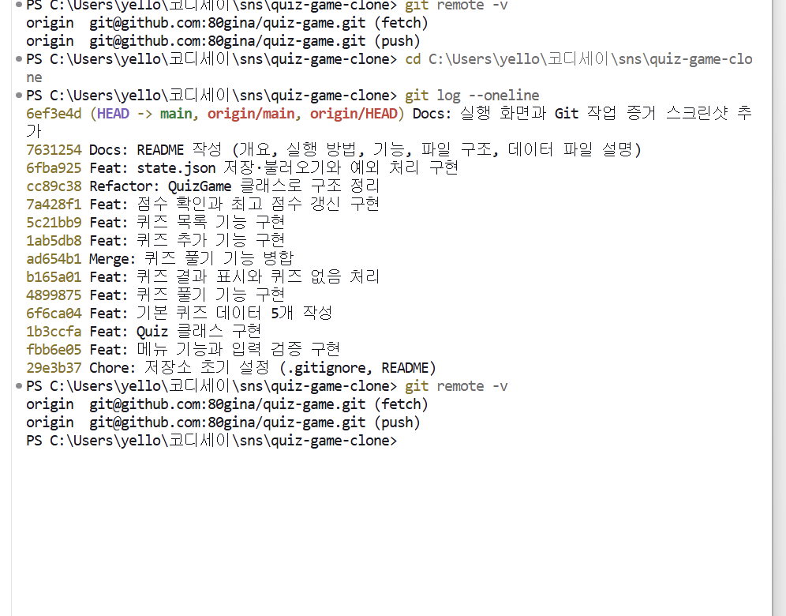

### 2~3) 복제본에서 수정, 커밋, push
복제본에서 추가한 한 줄 (`git show 70ed031`의 diff):
```diff
@@ -141,0 +142 @@ quiz-game/
+- clone 실습: 복제 저장소(quiz-game-clone)에서 이 줄을 추가하고 push했습니다.
```
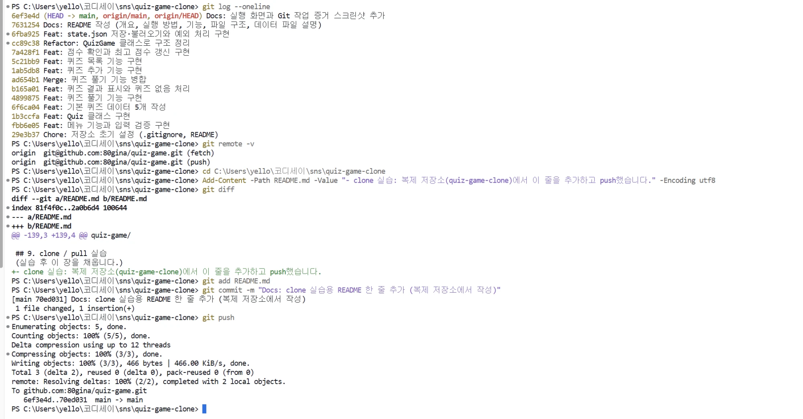

### 4~5) 원래 폴더에서 pull, 반영 확인
`pull` 전에는 README가 `(실습 후 이 장을 채웁니다.)`로 끝났고, `pull` 후에는 복제본에서 추가한 줄이 들어왔습니다. 충돌 없이 `Fast-forward`로 가져왔습니다.

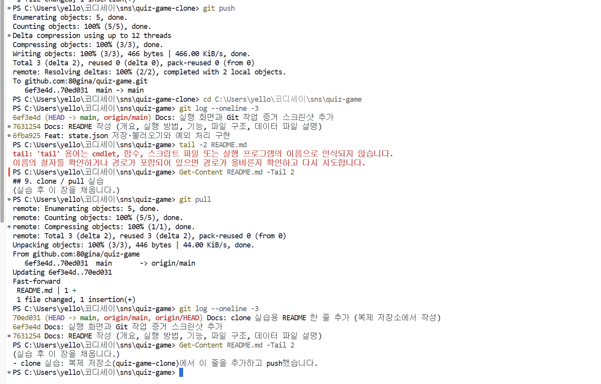

### clone과 pull의 차이
| | clone | pull |
|---|---|---|
| 하는 일 | 저장소 **전체**를 새 폴더에 복사 | 이미 가진 저장소에 **새로 바뀐 것만** 가져옴 |
| 쓰는 때 | 처음 시작할 때 한 번 | 그 뒤 매번 |

## 10. 겪은 오류와 해결
| 오류 | 원인 | 해결 | 화면 |
|---|---|---|---|
| `fatal: not a git repository` | 저장소가 아닌 상위 폴더(`sns`)에서 명령을 실행함 | `cd`로 `quiz-game`으로 이동 후 다시 실행 | 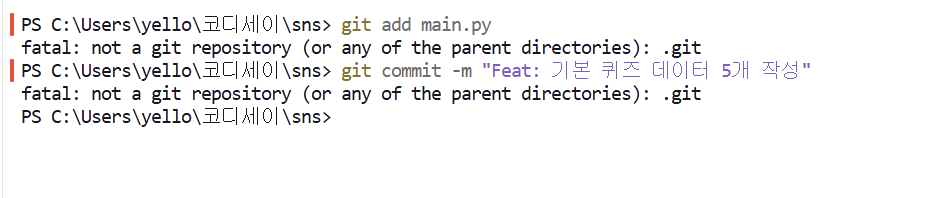 |
| `fatal: not a git repository` (`git push origin feature/play-quiz`) | 다른 터미널 탭이 상위 폴더에 있었음 | 맨 끝 폴더 이름을 확인하고 이동 | 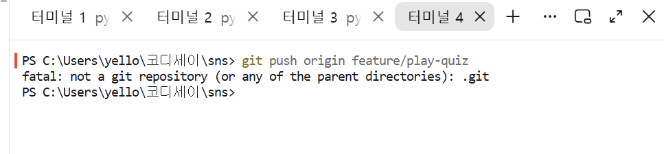 |
| 커밋 메시지가 기능과 다름 (`추가`로 적힌 `목록` 커밋) | 이전 커밋 명령을 그대로 반복함 | 올리기 전이라 `git commit --amend -m`으로 메시지만 수정 | (8장의 커밋 표에서 `목록` 커밋 확인) |

## 11. 개발 환경과 제출 증빙
### 개발 환경
| 항목 | 내용 | 과제 요구 |
|---|---|---|
| OS / 셸 | Windows 11 / PowerShell | - |
| Python | **3.14.7** | 3.10 이상 ✅ |
| Git | 2.53.0.windows.3 | - |
| 편집기 | VSCode | - |
| 외부 라이브러리 | 없음 (표준 라이브러리 `json`, `os`만 사용) | 외부 라이브러리 금지 ✅ |

### Git 설정
| 항목 | 값 |
|---|---|
| `user.name` | 설정함 |
| `init.defaultBranch` | `main` |
| `remote.origin.url` | `git@github.com:80gina/quiz-game.git` (SSH) |
| `branch.main` | `origin`의 `main`을 추적 |

이메일은 공개 저장소에 노출되지 않도록 `git config --list | Select-String -NotMatch "user.email"`로 **이메일 줄을 제외하고** 출력했습니다. (`init.defaultbranch`가 `master`와 `main`으로 두 번 보이는 것은 시스템 기본값 뒤에 내 설정(`main`)이 덮어써서 `main`이 적용되기 때문입니다.)

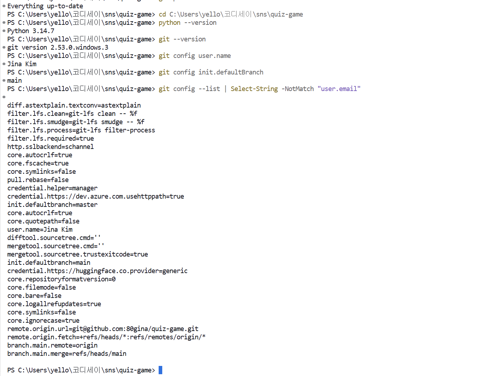

### 최종 커밋 그래프 (`git log --oneline --graph`)
커밋이 순서대로 쌓여 있고, `feature/play-quiz` 브랜치가 갈라졌다가 `Merge` 커밋으로 `main`에 합쳐진 것을 볼 수 있습니다.

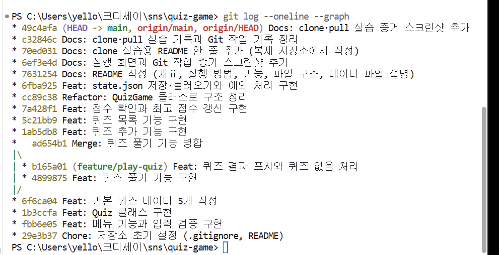

### 제출물 확인
| 제출물 | 위치 |
|---|---|
| GitHub 저장소 URL | https://github.com/80gina/quiz-game |
| 개발 환경 설정 스크린샷 (Python 버전, Git 설정) | 11장 `S40` |
| 프로그램 실행 결과 스크린샷 (추가, 목록, 플레이, 점수) | 7장 (`S19`, `S21`, `S9`, `S11`, `S23`) |
| `git log --oneline --graph` 출력 | 11장 `S41` |

## 12. 3번 미션 연결: AI 패턴 퀴즈

> 💬 **평가 질문 Q5** — 보너스(크레딧): 보너스 과제는 어디까지 했나요? → [답변 보기](docs/QNA.md#q5)

3번 미션(Mini NPU 시뮬레이터)에서 배운 **MAC 연산**을 이 퀴즈 게임 안에서 직접 체험하도록, 메뉴 `6. AI 패턴 퀴즈`를 만들었습니다. 브랜치 `feature/npu-quiz`에서 개발해 `main`에 병합했습니다.

### 연결된 저장소
| 미션 | 저장소 | 역할 |
|---|---|---|
| 2번 (이 저장소) | [80gina/quiz-game](https://github.com/80gina/quiz-game) | 퀴즈 게임, 메뉴 `6. AI 패턴 퀴즈`로 MAC 연산을 체험 |
| 3번 | [80gina/mini-npu](https://github.com/80gina/mini-npu) | Mini NPU 시뮬레이터 본편 (3x3 입력, `data.json` 일괄 판정, 성능 분석 O(N²), 결과 리포트, 보너스) |

두 저장소는 **MAC 연산·라벨 정규화·허용오차(1e-9) 비교 규칙과 `data.json` 형식**을 공유합니다. 3번 저장소는 같은 규칙을 콘솔 분석 도구로 완성한 것이고, 이 저장소는 그 규칙을 퀴즈 게임 안에서 쓰는 응용입니다.

### 어떤 기능인가요?
그림(■ = 1, □ = 0)을 보고 **Cross(십자가)인지 X인지** 맞히면, 이어서 **AI(MAC 연산)가 어떻게 계산해서 판정했는지**를 점수로 보여 줍니다. 마지막에는 **내 점수와 AI 점수**를 비교합니다.
```text
[패턴 문제 1] 이 그림은 Cross(십자가)일까요, X일까요?
□□■□□
□□■□□
■■■■■
□□■□□
□□■□□
  1. Cross (십자가)
  2. X
정답 번호(1~2): 1
--- AI(MAC)는 이렇게 계산했어요 ---
Cross 필터 점수: 9.0
X 필터 점수: 1.0
→ 점수가 더 큰 Cross로 판정!
```
| 개념 | 설명 |
|---|---|
| **MAC** | 패턴과 필터를 같은 위치끼리 **곱하고 모두 더한** 값 (`npu_core.mac`, 반복문으로 직접 구현) |
| **필터** | 십자가 모양과 X 모양을 숫자 판으로 만들어 둔 기준 |
| **판정** | 두 점수 중 큰 쪽. 차이가 `1e-9`보다 작으면 판정 불가(`UNDECIDED`) |

### 3번 미션과 연결한 점
| 연결 | 내용 |
|---|---|
| **같은 로직** | `npu_core.py`의 `mac`, `normalize_label`, `judge`(허용오차 비교)는 3번 미션의 규칙과 같습니다. 3번 미션 문서의 예시 값(십자가·십자가 필터 = 5, 십자가·X 필터 = 1)과 일치함을 확인했습니다. |
| **같은 데이터 형식** | `data.json`은 3번 미션과 같은 구조(`filters`의 `size_N`, `patterns`의 `size_N_idx` + `input` + `expected`)입니다. `expected`의 `+`, `x`는 표준 라벨(`Cross`, `X`)로 정규화합니다. |
| **상속** | `PatternQuiz`가 `Quiz`를 이어받아 `question`, `choices`, `answer`, `is_correct()`를 그대로 쓰고, 그림을 보여 주는 `show()`만 바꿔 씁니다. |
| **오류에도 안 멈춤** | `data.json`의 크기 불일치·라벨 오류는 `(건너뜀)`으로 안내하고 계속 진행하며, 파일이 없거나 깨지면 그림을 직접 만들어 진행합니다. |

### 2번 미션 요구와의 관계
2번 미션의 필수 요구(4지선다 퀴즈, `state.json`의 `quizzes`/`best_score` 형식, 입력 처리, Git 요구)는 **그대로 유지**하고, 패턴 퀴즈는 **추가 기능**으로 만들었습니다. 패턴 퀴즈의 점수는 `state.json`에 저장하지 않습니다.

### 실행 결과
| 화면 | 설명 |
|---|---|
| 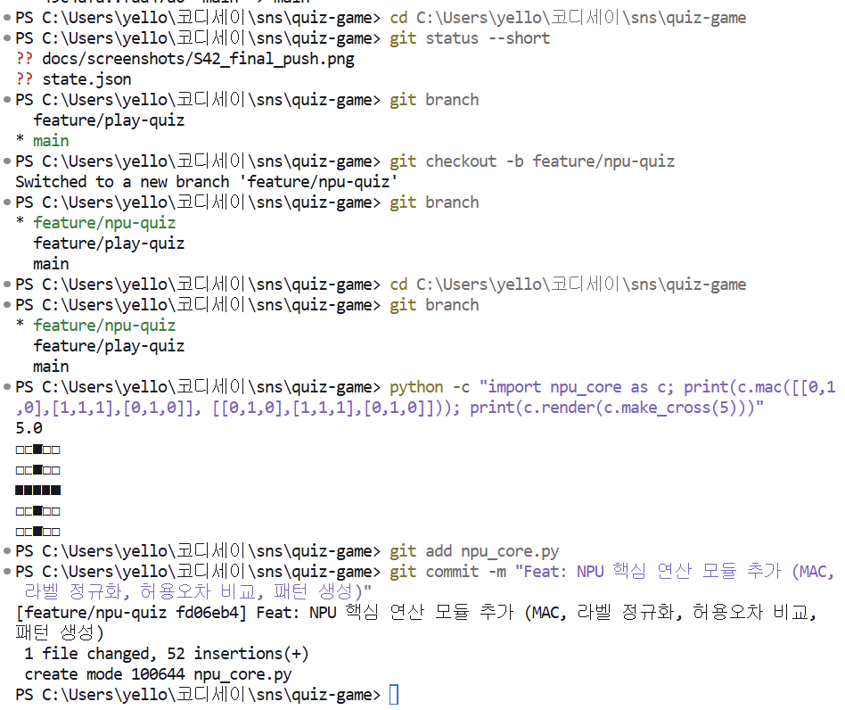 | `npu_core.py`의 MAC 결과(`5.0`)와 십자가 그림, 커밋 |
| 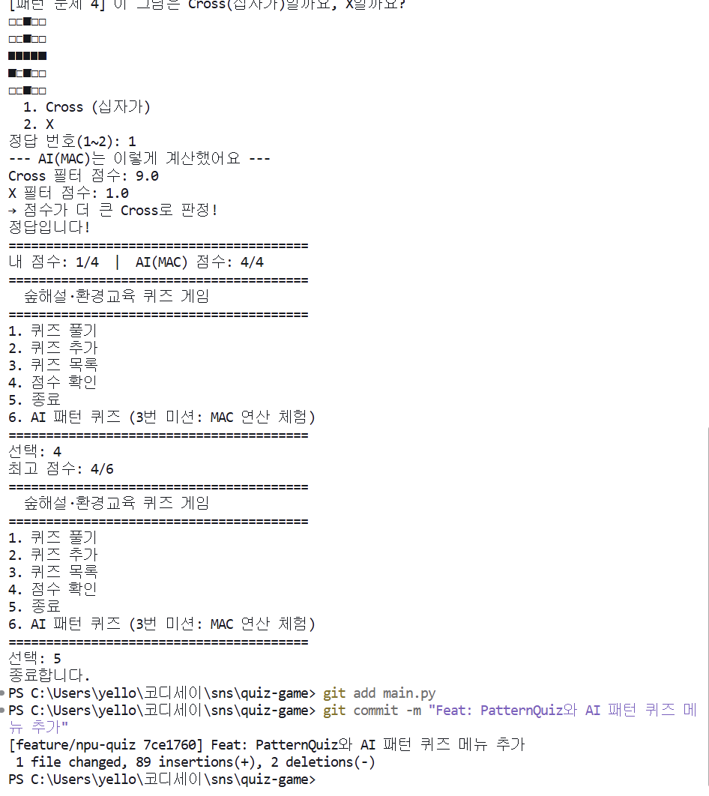 | AI 패턴 퀴즈 실행(내 점수와 AI 점수 비교)과 커밋 |
| 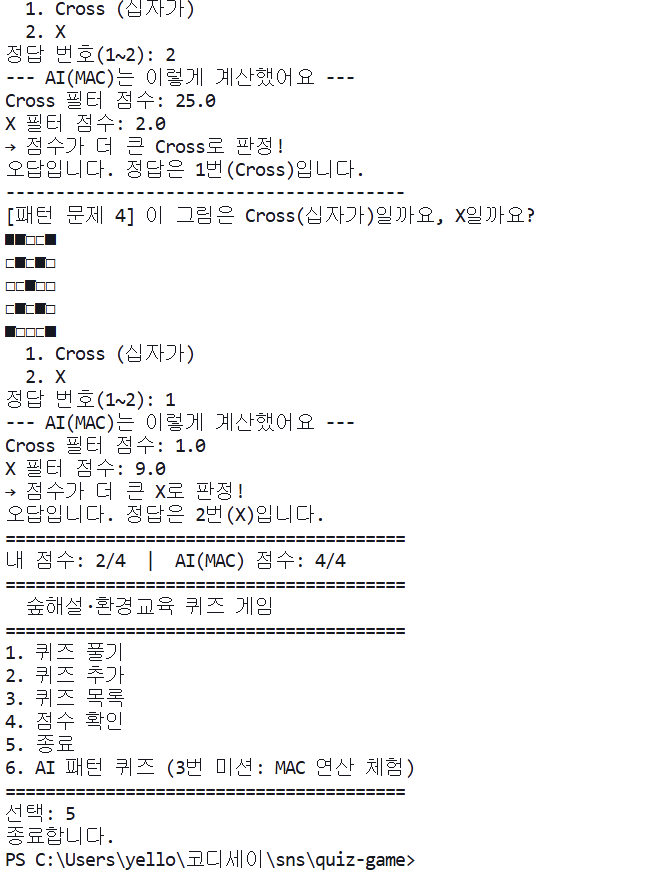 | `data.json`의 패턴으로 출제, 13×13 그림과 흐트러진 그림도 AI가 판정 |
| 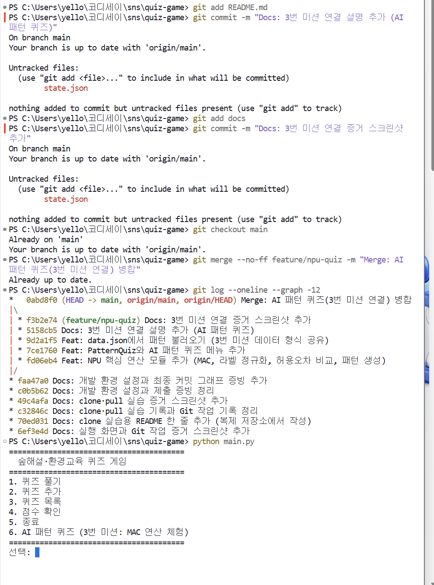 | **병합 후** `main`: `git log --graph`에 갈라졌다 합쳐지는 `Merge: AI 패턴 퀴즈(3번 미션 연결) 병합`이 보이고, 메뉴에 `6. AI 패턴 퀴즈`가 나타남 |

## 13. 평가 피드백 반영 (보완 내용)
평가에서 지적된 점을 코드와 문서에 반영했습니다.

### 13-1. 퀴즈 1000개 이상일 때의 성능·메모리 (직접 측정) 🔧 반복 측정으로 보강

> 💬 **평가 질문 Q4-1** — 퀴즈가 1000개 이상이 되면 JSON 방식의 한계는? → [답변 보기](docs/QNA.md#q4-1)

`save()`와 `load()`를 퀴즈 수별로 **반복 측정해 평균(최소~최대)** 을 냈습니다. (1000·1만 개는 5회, 10만 개는 3회, 같은 컴퓨터, `category` 필드 포함)

| 퀴즈 수 | 저장 평균(ms) (최소~최대) | 불러오기 평균(ms) (최소~최대) | 파일 크기 | 메모리 |
|---|---|---|---|---|
| 1,000 | 15.8 (12.9~17.5) | 55.7 (44.0~61.9) | 185 KB | 1.0 MB |
| 10,000 | 120.6 (112.4~128.1) | 198.4 (181.7~231.3) | 1.8 MB | 9.5 MB |
| 100,000 | 2038.5 (1635.4~2271.6) | 3499.7 (3371.4~3666.9) | 18.2 MB | 93.9 MB |

- **시간·메모리 복잡도:** 저장, 불러오기, 메모리가 모두 **O(n)** 입니다. 퀴즈 수가 10배가 되면 시간과 메모리도 약 10배가 됩니다. 반복해도 값의 흔들림은 ±15% 안팎이라 결론은 같습니다.
- **1000개에서는 문제가 없습니다.** 저장이 약 16ms라 체감되지 않습니다. 한계는 **수만 개 이상**에서 보입니다. 퀴즈를 추가할 때마다 **전체 파일을 다시 쓰기 때문**입니다(10만 개에서 약 2초).
- **그 밖의 한계:** 시작할 때 전부 메모리에 올리고, 조건 검색은 처음부터 훑고, 여러 프로그램이 동시에 쓰면 충돌합니다.
- **개선 방안:** 표준 라이브러리 `sqlite3`(인덱스, 일부만 읽기/쓰기, 트랜잭션), 또는 카테고리별로 파일을 나눠 필요한 것만 읽기. 현재 규모(수십 개)에서는 JSON이 단순해서 적합합니다.

### 13-2. 요구 변경 시 수정 대상과 우선순위

> 💬 **평가 질문 Q4-3** — 채점 방식이나 퀴즈 구조(선택지 개수)가 바뀌면 어디를 먼저 수정하나요? → [답변 보기](docs/QNA.md#q4-3)

| 바뀌는 요구 | 먼저 볼 곳 (우선순위 순) |
|---|---|
| **점수 계산** (감점, 가중치 등) | ① `QuizGame.play()`의 점수 계산 ② `show_score()` 표시 ③ `best_score` 저장 형식(`save`/`load`) ④ README 스키마 |
| **채점 방식** (복수 정답 등) | ① `Quiz.is_correct()` ② `Quiz` 속성(`answer`) ③ `from_dict`/`to_dict` ④ `state.json` 호환 |
| **선택지 개수** | ① `NUM_CHOICES` 상수 (검증·입력·출력에 쓰임) ② 기본 퀴즈 데이터 `default_quizzes()` ③ 기존 `state.json` 호환(옛 파일은 손상으로 판단됨) ④ README |
| **저장 방식** (DB 등) | `load()`, `save()`만 (진행 코드는 그대로) |
| **입력 규칙** | `read_line()`, `read_int()`만 |

### 13-3. 손상 복구와 안전한 저장

> 💬 **평가 질문 Q3-3** — 파일 입출력에서 `try/except`가 필요한 이유는? → [답변 보기](docs/QNA.md#q3-3)
>
> 💬 **평가 질문 Q4-2** — `state.json`이 손상되어 파싱에 실패하면 데이터를 잃지 않게 하려면? → [답변 보기](docs/QNA.md#q4-2)

- 손상 감지 시 파일을 지우지 않고 **`state.json.bak`로 보관**한 뒤 기본 퀴즈로 시작합니다. (사용자가 추가한 퀴즈를 되살릴 수 있음)
- 저장은 **임시 파일 → 교체**(`os.replace`) 방식입니다.
- **권한 오류·디스크 부족 복구 절차:** 저장 실패 안내가 나오면 ① 폴더 쓰기 권한(읽기 전용 속성)을 확인하고 ② 디스크 공간을 확보한 뒤 ③ 프로그램을 다시 실행합니다. 실패한 저장은 기존 `state.json`을 건드리지 않으며, 메모리의 변경은 다음 저장 때 다시 시도됩니다.
- **수동 복구:** `state.json.bak`를 열어 깨진 부분을 고친 뒤 `state.json`으로 이름을 바꿉니다.

### 13-4. 종료 이벤트 지원 범위
| 이벤트 | 지원 | 동작 |
|---|---|---|
| Ctrl+C (SIGINT, `KeyboardInterrupt`) | ✅ | 안내 후 저장하고 종료 |
| 입력 스트림 종료 (EOF, Ctrl+D/Ctrl+Z) | ✅ | 안내 후 저장하고 종료 |
| SIGTERM(종료 요청)·SIGHUP(터미널 끊김, 윈도우에는 없음) | ✅ 🔧 핸들러 등록 | `install_signal_handlers()`가 Ctrl+C와 같이 취급해 안내 후 저장하고 종료 (윈도우는 SIGTERM만, 강제 종료(`kill -9`)는 어떤 프로그램도 막을 수 없음) |

### 13-5. 기본 퀴즈 개수 확인 (간단한 테스트)
```bash
python -c "import main; print(len(main.default_quizzes()))"
```
출력: `5`

## 14. 2차 평가 피드백 반영 (보완 내용)
2차 평가에서 **PASS 18개, 보완 의견 18건**을 받았습니다. 보완한 곳은 아래 아이콘으로 표시했습니다.

| 아이콘 | 뜻 |
|---|---|
| 🔧 | 코드를 고침 (`main.py`) |
| 🧪 | 자동 테스트를 추가함 (`test_quizgame.py`) |
| 📝 | 문서(README)를 보강함 |
| 📊 | 측정·증빙 자료를 보강함 |

### 14-1. 보완 내역 한눈에 보기
| 평가 | 지적 | 보완 | 표시 |
|---|---|---|---|
| #1 | 메뉴 흐름 자동 검증 없음 | 메뉴 시나리오 테스트 추가 (`FlowTests`) | 🧪 |
| #2 | 정오답 판정의 예외 케이스 문서 없음 | 14-2에 정리 | 📝 |
| #3 | 동시 쓰기 대비 운영 절차 없음 | 14-3에 권장 절차 | 📝 |
| #4 | 기본 퀴즈 확장용 메타 없음 | `category` 필드 추가 (기존 파일과 호환) | 🔧 🧪 |
| #5 | 커밋 목록 텍스트 없음 | 14-4에 `git log --oneline` 출력 첨부 | 📊 |
| #6 | 병합 텍스트 증빙 일부 스크린샷 의존 | 14-4에 `git log --merges` 출력 첨부 | 📊 |
| #7 | clone/pull 터미널 텍스트 없음 | 14-5에 명령과 출력 텍스트 첨부 | 📊 |
| #8 | 책임 분리를 테스트로 검증 안 함 | `QuizTests`(Quiz 책임), `InputTests`·`StorageTests`(QuizGame 책임) | 🧪 |
| #9 | 메서드 docstring 부족 | 모든 `QuizGame`·`Quiz` 메서드에 한 줄 docstring | 🔧 |
| #10 | 실패 시 권장 조치 한 줄 없음 | 14-6에 복원 명령 한 줄 | 📝 |
| #11 | SIGTERM·SIGHUP 미처리 | 신호 핸들러 구현, 13-4 표 수정, 테스트 | 🔧 🧪 📝 |
| #12 | 커밋 크기 정량 규정 없음 | 14-7에 권장값 | 📝 |
| #13 | 추상 클래스 장단점 없음 | 14-8에 정리 | 📝 |
| #14 | DB 전환 전략 요약만 있음 | 14-9에 한 문단 | 📝 |
| #15 | 재시도·로그 절차 없음 | 저장 **3회 재시도 구현**, 로그 권장 절차 문서화 | 🔧 🧪 📝 |
| #16 | 단일 측정치 | **반복 측정(5회·3회) 평균**으로 13-1 표 교체 | 📊 |
| #17 | 수동 복구 단계 요약만 있음 | 14-6에 단계별 절차 | 📝 |
| #18 | 회귀 검증 절차 없음 | 14-10에 회귀 체크리스트, 테스트 19개 | 🧪 📝 |

### 14-2. 정오답 판정의 예외 케이스 📝
- `Quiz.is_correct(choice)`는 입력 번호와 정답 번호를 비교만 합니다. **입력 범위(1~4)·숫자 변환은 `QuizGame.read_int`가 먼저 검증**하므로 `is_correct`에는 항상 1~4의 정수만 들어옵니다.
- 정답 번호가 이상한 **비정상 데이터**(선택지가 4개가 아니거나 정답이 1~4 밖)는 `Quiz.from_dict()`가 `ValueError`로 거부하고, `load()`가 이를 손상으로 보아 `.bak`로 보관 후 복구합니다. 그래서 잘못된 퀴즈가 채점 단계까지 오지 않습니다. 🧪 `test_from_dict_rejects_bad_data`

### 14-3. 동시 실행 시 권장 운영 절차 📝

> 💬 **평가 질문 Q4-5** — 두 프로그램이 동시에 실행되면? → [답변 보기](docs/QNA.md#q4-5)

- 이 프로그램은 **한 번에 한 개만 실행**하는 것을 전제로 합니다. 두 개가 동시에 `state.json`을 쓰면 나중에 저장한 쪽이 이깁니다(마지막 저장 우선).
- 권장 절차: ① 실행 전 다른 창에서 같은 프로그램이 켜져 있는지 확인 ② 여러 명이 쓸 때는 각자 복제본(`git clone`)에서 따로 실행 ③ 퀴즈를 합칠 때는 `state.json`을 직접 합치지 말고 한 사람이 `퀴즈 추가` 메뉴로 넣기. 저장은 임시 파일 후 교체라 **파일이 반쯤 쓰이는 일은 없지만**, 두 프로그램의 변경이 합쳐지지는 않습니다.

### 14-4. 커밋 로그 텍스트 📊
`git log --oneline` (이 보완 작업 전 시점, 최신이 위):
```text
a3d9a98 Docs: 평가 피드백 반영 (대용량 성능 측정, 요구 변경 영향 목록, 복구 절차 등)
a5e2806 Fix: state.json 손상 시 .bak 백업, 임시 파일 후 교체 저장, 선택지 개수 상수화
032d966 Docs: README에 3번 미션(mini-npu) 저장소 링크 연결
fcba1d3 Docs: 두 번째 병합 증거와 커밋 표 해시 정리
0abd8f0 Merge: AI 패턴 퀴즈(3번 미션 연결) 병합
f3b2e74 Docs: 3번 미션 연결 증거 스크린샷 추가
5158cb5 Docs: 3번 미션 연결 설명 추가 (AI 패턴 퀴즈)
9d2a1f5 Feat: data.json에서 패턴 불러오기 (3번 미션 데이터 형식 공유)
7ce1760 Feat: PatternQuiz와 AI 패턴 퀴즈 메뉴 추가
fd06eb4 Feat: NPU 핵심 연산 모듈 추가 (MAC, 라벨 정규화, 허용오차 비교, 패턴 생성)
faa47a0 Docs: 개발 환경 설정과 최종 커밋 그래프 증빙 추가
c0b5b62 Docs: 개발 환경 설정과 제출 증빙 정리
49c4afa Docs: clone·pull 실습 증거 스크린샷 추가
c32846c Docs: clone·pull 실습 기록과 Git 작업 기록 정리
70ed031 Docs: clone 실습용 README 한 줄 추가 (복제 저장소에서 작성)
6ef3e4d Docs: 실행 화면과 Git 작업 증거 스크린샷 추가
7631254 Docs: README 작성 (개요, 실행 방법, 기능, 파일 구조, 데이터 파일 설명)
6fba925 Feat: state.json 저장·불러오기와 예외 처리 구현
cc89c38 Refactor: QuizGame 클래스로 구조 정리
7a428f1 Feat: 점수 확인과 최고 점수 갱신 구현
5c21bb9 Feat: 퀴즈 목록 기능 구현
1ab5db8 Feat: 퀴즈 추가 기능 구현
ad654b1 Merge: 퀴즈 풀기 기능 병합
b165a01 Feat: 퀴즈 결과 표시와 퀴즈 없음 처리
4899875 Feat: 퀴즈 풀기 기능 구현
6f6ca04 Feat: 기본 퀴즈 데이터 5개 작성
1b3ccfa Feat: Quiz 클래스 구현
fbb6e05 Feat: 메뉴 기능과 입력 검증 구현
29e3b37 Chore: 저장소 초기 설정 (.gitignore, README)
```
`git log --merges` (병합 커밋과 부모, 병합이 2회임을 확인):
```text
0abd8f0  (부모 faa47a0 f3b2e74)  Merge: AI 패턴 퀴즈(3번 미션 연결) 병합
ad654b1  (부모 6f6ca04 b165a01)  Merge: 퀴즈 풀기 기능 병합
```

### 14-5. clone / pull 실습 터미널 텍스트 📊
README 9장의 실습 기록을 그대로 옮긴 텍스트입니다. (해시는 당시 출력)
```text
$ git clone git@github.com:80gina/quiz-game.git quiz-game-clone      # sns/ 에서
$ cd quiz-game-clone
$ (README 끝에 한 줄 추가)  →  git add README.md  →  git commit      # 커밋 70ed031
$ git push
   6ef3e4d..70ed031  main -> main
$ cd ../quiz-game                                                    # 원래 폴더
$ git pull
Updating 6ef3e4d..70ed031
Fast-forward
 README.md | 1 +
$ git log --oneline -3                                               # 맨 위에 70ed031
```

### 14-6. 저장 실패·손상 시 수동 복구 절차 📝
- **한 줄 복원(윈도우 PowerShell):** `Copy-Item state.json.bak state.json` (먼저 `.bak`를 열어 깨진 부분을 고친 뒤)
1. 프로그램을 끕니다.
2. `state.json.bak`를 메모장이나 VSCode로 엽니다. (퀴즈가 `{"quizzes": [...], "best_score": N}` 모양이어야 합니다.)
3. 깨진 곳(빠진 따옴표·쉼표·괄호)을 고칩니다. VSCode는 오류 위치에 빨간 줄을 표시합니다.
4. 고친 파일을 `state.json`으로 이름을 바꾸거나 위 복원 명령으로 복사합니다.
5. `python main.py`를 실행해 "저장된 퀴즈 N개"가 목록에 보이는지 확인합니다. 그래도 손상이면 `.bak`를 두고 기본 퀴즈로 시작합니다.
- **저장 실패 안내가 계속 나올 때:** 폴더 쓰기 권한과 디스크 공간을 확인합니다. 🔧 저장은 **최대 3번(0.2초 간격) 재시도**하고, 모두 실패하면 안내만 하고 계속 실행합니다(`SAVE_RETRIES`).
- **로그 기록(권장 절차):** 운영 환경에서는 실패 메시지를 `quiz.log` 같은 파일에 남기도록 `print` 대신 `logging` 모듈로 바꿉니다. 이 과제 규모에서는 콘솔 안내로 충분해 구현하지 않았습니다.

### 14-7. 커밋 크기 기준 📝
한 커밋은 **기능(또는 문서) 하나, 파일 1~3개, 변경 100줄 안팎**을 권장합니다. 이 저장소의 실제 평균은 **커밋당 파일 약 2.7개, 변경 약 77줄**(`git log --shortstat` 기준)입니다.

### 14-8. 추상 베이스 클래스(ABC) 도입 시 📝

> 💬 **평가 질문 Q4-6** — 추상 클래스(ABC)를 안 쓴 이유는? → [답변 보기](docs/QNA.md#q4-6)

`abc.ABC`로 `BaseQuiz`를 만들고 `show()`·`is_correct()`를 `@abstractmethod`로 두면, `Quiz`와 `PatternQuiz`가 반드시 같은 메서드를 갖도록 **강제**할 수 있고 새 퀴즈 종류(OX, 주관식)를 추가할 때 빠뜨리는 실수를 막습니다. 대신 클래스가 하나 늘어 구조가 복잡해지고, `from_dict`·`to_dict`의 변환 규칙도 종류별로 나눠야 합니다. 퀴즈 종류가 2개뿐인 지금은 상속만으로 충분해 도입하지 않았습니다.

### 14-9. sqlite3로 옮길 때 📝
`sqlite3`(표준 라이브러리)는 **인덱스·일부만 읽고 쓰기·트랜잭션**이 장점이라 수만 개 이상과 동시 접근에 강하지만, 파일을 사람이 열어 고칠 수 없고 스키마(`quizzes` 표, `meta` 표)와 SQL을 관리해야 합니다. 수정 지점은 **`load()`·`save()` 두 메서드와 기존 `state.json`을 한 번 읽어 옮기는 이전(마이그레이션) 함수**뿐이고, `Quiz`와 게임 진행 코드는 그대로입니다. 이것이 입력·진행·저장을 분리해 둔 이유입니다.

### 14-10. 요구 변경 후 회귀 체크리스트 🧪 📝
요구를 바꾼 뒤에는 아래 순서로 확인합니다.
1. `python test_quizgame.py` → 테스트 19개가 모두 `OK`인지 (🧪 자동)
2. `python -c "import main; print(len(main.default_quizzes()))"` → `5`
3. `python main.py`에서 **풀기 → 추가 → 목록 → 점수 → 종료 → 재실행**으로 데이터가 남는지 (수동)
4. 일부러 `state.json`을 깨뜨려 실행 → `.bak` 보관과 복구 안내가 나오는지
5. `abc`, 빈 입력, `9`, `Ctrl+C`를 입력해도 Traceback 없이 안내만 나오는지

### 14-11. 테스트 구성 🧪

> 💬 **평가 질문 Q4-4** — 자동 테스트는 무엇을 검증하나요? → [답변 보기](docs/QNA.md#q4-4)

| 테스트 클래스 | 검증하는 책임 | 개수 |
|---|---|---|
| `QuizTests` | `Quiz`: 채점, 변환, 형식 검증, 기본 퀴즈 5개 | 5 |
| `InputTests` | `QuizGame`: 입력 검증 (공백·빈 입력·문자·범위·Ctrl+C·EOF) | 3 |
| `FlowTests` | 메뉴 시나리오, 점수 갱신, 재시작 후 유지, EOF 안전 종료 | 5 |
| `StorageTests` | 저장/불러오기: 첫 실행, 손상 `.bak`, 임시 파일 교체, 재시도 | 5 |
| `SignalTests` | SIGTERM 핸들러가 Ctrl+C처럼 동작 | 1 |

테스트는 임시 폴더의 파일로 실행하므로 내 `state.json`은 바뀌지 않습니다.

📊 실행 화면 (마지막 8줄: `Ran 19 tests` / `OK`). 글자가 빨간 것은 `unittest`가 결과를 표준 오류로 출력해 PowerShell이 빨갛게 보여 주는 것이며 오류가 아닙니다.

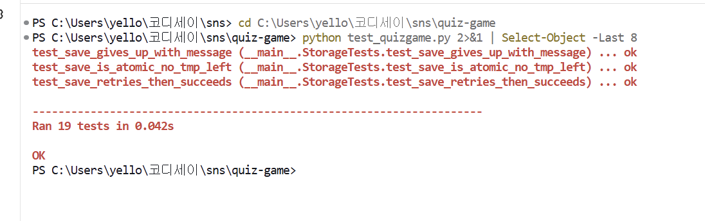

## 15. 🐳 Docker로 실행하기 (1번 미션 연결)
1번 미션에서 배운 Docker로 이 게임을 이미지로 만들었습니다. 이미지는 **`quiz-game:1.0`** 이고 Docker Desktop의 **Images** 탭에 나타납니다.

| 파일 | 역할 |
|---|---|
| `Dockerfile` | `python:3.12-slim`(Python 3.10 이상 요구 충족)에 `main.py`, `npu_core.py`, `data.json`을 담음 |
| `.dockerignore` | `state.json`, `.git`, `docs/`처럼 이미지에 넣지 않을 것을 지정 |

```powershell
docker build -t quiz-game:1.0 .
docker run --rm -it -v quizdata:/data quiz-game:1.0
docker run --rm quiz-game:1.0 python test_quizgame.py
```
| 명령 | 뜻 |
|---|---|
| `docker build -t quiz-game:1.0 .` | 이미지를 만듭니다 (약 203 MB) |
| `docker run --rm -it -v quizdata:/data quiz-game:1.0` | 게임 실행. `-it`는 키보드 입력용, `-v quizdata:/data`는 **볼륨**을 `/data`에 연결, `--rm`은 끝나면 컨테이너를 지움 |
| `docker run --rm quiz-game:1.0 python test_quizgame.py` | 이미지 안에서 자동 테스트 19개 실행 |

**데이터가 남는 이유:** 🔧 `state.json` 위치를 환경 변수 `QUIZ_STATE_FILE`로 바꿀 수 있게 했고(기본값은 `main.py` 옆 그대로), 이미지는 이 값을 `/data/state.json`으로 둡니다. `/data`에 볼륨(`quizdata`)을 연결하면 **컨테이너를 지워도 퀴즈와 최고 점수가 남습니다.** (1번 미션의 볼륨 실습과 같은 원리)

📊 확인한 결과: 컨테이너에서 퀴즈를 추가하고 종료한 뒤 **새 컨테이너로 다시 실행해도 6개로 유지**되었고, 이미지 안의 테스트 19개가 모두 `OK`였습니다. 게임은 키보드 입력이 필요하므로 Docker Desktop의 **Run 버튼**보다 터미널에서 `-it`로 실행하는 것을 권장합니다.
